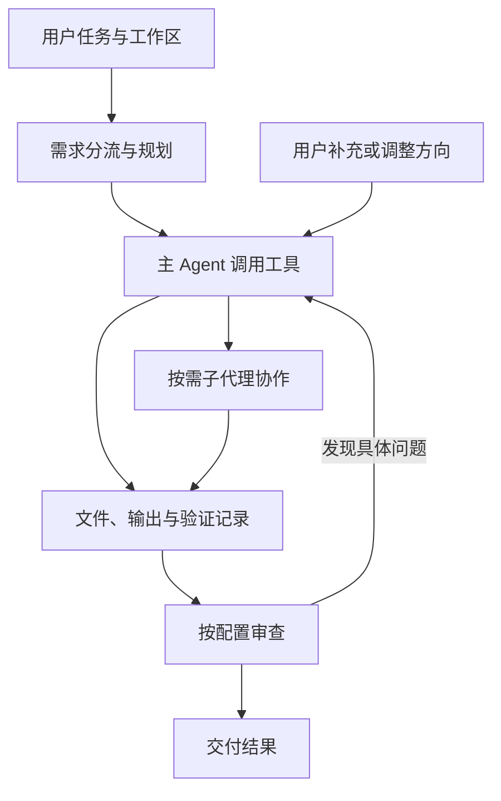

# SandwichAgent

**在本地运行、可接入自选模型的桌面 Agent 工作台。**

把一个任务交给 Agent，让它规划、调用工具、按需派发子代理，再结合实际输出与审查意见完成修改和交付。执行过程、文件改动、等待中的任务和审查结果都可以在界面中查看；跑偏时可以直接介入，中断后也可以继续。

项目使用 **Rust + Tauri 2 + Vue 3** 构建。桌面应用目前仍显示为 **Free API Chat**，仓库名为 `free_api`；项目不提供免费的模型 API 或调用额度，需要使用你自己的模型服务。

[快速开始](#quick-start) · [模型与协作](#models) · [架构说明](docs/architecture.md) · [常见问题](#faq) · [参与贡献](#contributing)

## 能用它做什么

- **代码排查与修改**：读取项目、检索调用关系、运行命令、修改文件，再通过构建、测试或运行时观测核对结果。
- **需要多步推进的本地任务**：整理文件、处理资料、生成产物，并在执行中保留进度和输出引用。
- **按需协作与审查**：让主 Agent 分派只读调查、隔离写入或独立审查任务，查看各成员的过程和结果。
- **研究 Agent 本身**：观察模型路由、上下文压缩、工具协议、检查点恢复，以及审查对质量与成本的实际影响。

它适合愿意配置模型、希望看清执行过程，也愿意在关键处参与判断的开发者和个人用户。项目持续迭代中，任务结果仍需要结合实际验证判断。

## 几个值得关注的设计

### 按职责使用模型

Pro、Flash、Vision 是可配置的职责槽位，分别用于规划推理、日常执行和图片观察，可以绑定同一个模型，也可以组合不同服务。子代理和审查角色还可以配置各自的模型。

新附件先形成可复用的图片观察，保存结果与原图引用后，再按任务阶段选择模型；需要核对视觉细节时可以回看原图。观察失败时保留原图与视觉处理路径，避免初始截图成功观察后仍长期占用视觉路由。

### 长任务有可以接续的状态

“三明治上下文”把相对稳定的规则和目标、历史执行记录、当前动态状态分开组织。长输出保留原始记录与 `output_id` 引用，压缩后可以按需搜索和回查；检查点保存任务状态，支持中断与续跑。

稳定前缀有助于复用供应商缓存，但命中率、延迟和费用仍取决于实际接口与任务，项目不承诺固定节省比例。

### 协作过程可以检查，也可以干预

子代理区分只读调查、隔离写入和审查职责。审查可以出现在方案、执行阶段或收尾阶段，具体触发取决于模式与配置。多人审查保留成员各自的意见，也支持停止并在本任务后续审查中排除指定成员。

宿主负责路径权限、执行记录和状态提交等可核对的事实；模型负责需要理解任务的判断。审查是质量过滤环节，不能保证发现所有问题。

### 工具执行与交付证据相连

文件变更、命令输出、后台任务和验证记录会进入执行轨迹。五路以内的独立工具操作可以同批并行；子代理使用自己的异步派发与回收通道。主 Agent 可以根据审查反馈继续修复，并复用仍适用的验证证据。



<a id="quick-start"></a>
## 快速开始

### 1. 准备开发环境

- **Node.js 22 或 24 LTS 与 npm**，版本状态见 [Node.js 发布表](https://nodejs.org/en/about/previous-releases)。
- **Rust stable / Cargo**。
- **Git、ripgrep**，并确保 `rg` 在命令搜索路径中。
- 按操作系统安装 [Tauri 2 平台依赖](https://v2.tauri.app/start/prerequisites/)：Linux 需要相应的 GTK/WebKit 开发包，Windows 需要 C++ 构建工具和 WebView2，macOS 需要 Xcode 命令行工具。

MCP 服务或具体任务使用的 Python、Node 等运行环境按需安装，不要求为了第一次启动就配置所有插件。

### 2. 从源码启动

```bash
git clone https://github.com/qqw52491-hue/free_api.git
cd free_api
npm ci
npm run tauri -- dev
```

首次启动需要下载并编译 Rust 依赖，耗时取决于网络和本机环境。Linux Wayland 如遇 WebView 显示问题，可以尝试仓库提供的启动脚本：

```bash
npm run dev:wayland
```

`npm run dev` 只启动前端开发服务。完整桌面功能依赖 Tauri 后端，请使用上面的桌面启动命令。

### 3. 配置模型并完成第一个任务

1. 打开 **渠道与模型管理**，添加平台的 Base URL 和 API Key，再手动添加模型，或使用“从接口拉取模型”。当前模型调用走 OpenAI 兼容的 Chat Completions 接口，接口地址与实际模型标识需要匹配服务商配置。
2. 在 Agent 输入区打开 **模型路由与专家小队**，选择 Pro、Flash 和 Vision。初次可以复用已有模型来减少配置；处理图片时，Vision 槽应选择支持图片输入的模型和接口。
3. 为会话绑定需要操作的项目工作区。只授予任务需要的目录，额外目录可以按需授权。
4. 先提交一个范围明确的小任务。例如：

   > 检查这个项目的启动脚本，说明开发和构建分别运行什么，先不要修改文件。

5. 查看工具输出和交付结果；需要调整目标时直接补充说明。后续再尝试修改文件、运行验证或启用更多协作角色。

普通本地任务可以先使用内置文件与终端工具，MCP 和专业角色卡按任务需要添加。

<a id="models"></a>
## 模型与协作配置

| 配置 | 作用 | 使用时需要了解 |
| --- | --- | --- |
| Pro | 推理与规划槽位 | 开放式诊断、方案选择等任务会受模型规划能力影响 |
| Flash | 日常执行槽位 | 名称不代表固定厂商或固定模型；可以与 Pro 使用相同模型 |
| Vision | 图片观察槽位 | 必须由实际支持图片输入的接口与模型承担 |
| Worker | 只读子任务 | 适合边界明确的调查与证据收集 |
| Writer | 隔离写入子任务 | 先在副本中修改，再检查冲突并合入工作区 |
| Reviewer | 独立审查 | 配合当前模式检查方案、改动或交付材料 |

多角色不要求使用多个厂商，也不自动意味着更高质量。审查人数、模型能力和任务拆分都会影响耗时与费用；一次有效的运行时观测，有时比增加审查轮数更有价值。

### 可选的联网搜索配置

内置搜索会尝试可用的数据源。以下服务的 Key 通过启动桌面进程时的环境变量读取：

| 环境变量 | 对应服务 |
| --- | --- |
| `TINYFISH_API_KEY` | TinyFish |
| `TAVILY_API_KEY` | Tavily |
| `BRAVE_API_KEY` | Brave Search |

未配置时仍会尝试无需 Key 的回退来源，其可用性与结果覆盖受网络和来源限制。代码不附带共享的搜索服务密钥；环境变量需要由系统或启动终端设置，项目不自动加载 `.env` 文件。

## 数据、权限与费用

- **本地保存状态，模型请求按配置发送。** 聊天与任务状态保存在本地 SQLite，运行输出及附件还可能保存在文件中。使用远端模型时，请求中包含的用户内容、图片、源码片段或工具输出会发送到所选服务；“本地应用”不等于“所有数据离线处理”。
- **使用你自己的服务额度。** 主 Agent、子代理、审查和重试都可能产生模型调用。耗时、Token 与缓存指标用于观察，实际账单以服务商为准。
- **工具拥有实际执行能力。** 文件与终端工具可以修改授权工作区或运行命令；建议先在可恢复的项目副本或 Git 工作区中试用。
- **分享日志前先检查内容。** 数据库可能保存平台凭据，运行日志可能包含提示词、图片、源码与任务内容。不要把自己的数据库、附件、日志、私钥或带凭据的插件配置提交到公共仓库。`.gitignore` 不会清理已经进入 Git 历史的数据。

<a id="faq"></a>
## 常见问题

**为什么配置了几个槽位，却还是同一个模型在执行？**

槽位名称表示职责，实际使用哪个模型由绑定配置决定。同一模型可以承担多个职责，调用记录可用于核对实际路由。

**任务变慢是否说明质量一定更高？**

需要看新增步骤是否带回新证据或完成必要验证。反复读取、无效重试与重复审查也会消耗时间；遇到问题时可以结合运行轨迹定位，并随时调整方向或停止。

**中断或重启后能否继续？**

任务状态支持检查点恢复；外部进程与第三方服务不能随检查点原样恢复，恢复时仍可能需要重新确认环境或补做操作。

**Windows、macOS、Linux 都能打包吗？**

项目使用 Tauri 桌面技术栈，但打包依赖目标平台的工具链和系统组件。先在对应平台完成依赖安装与构建验证；仅安装 Rust target 不代表具备完整跨平台打包环境。仓库中的 CI 任务也不等于所有安装包均已验证。

**能直接发布自己构建的安装包吗？**

先核对应用标识、更新地址与签名配置。当前 [`tauri.conf.json`](src-tauri/tauri.conf.json) 开启了更新产物，二次分发应使用自己的更新端点和签名配置，或按需关闭更新产物生成。生成更新签名需要配置私钥环境变量，详见 [Tauri Updater 文档](https://v2.tauri.app/plugin/updater/)。私钥不应进入仓库。 完整步骤见 [三平台发布与 GitHub 更新指南](docs/releasing.md)。 发布时可用 `npm run release -- v0.1.1` 自动同步版本、提交和推送标签；加 `--dry-run` 可以先预览。

应用在启动和前台每小时检查 GitHub Release，侧栏底部“应用更新”可下载并安装新版本；更新分发独立于微信和内网穿透。首次发布还需跑通 CI 并实测升级；Linux AppImage 使用内置更新，deb/rpm 从发布页手动安装。

## 开发与验证

```bash
# 前端类型检查与构建
npm run build

# Rust 检查与库测试
cargo check --manifest-path src-tauri/Cargo.toml --tests
cargo test --manifest-path src-tauri/Cargo.toml --lib

# 构建当前平台的桌面可执行程序，不生成安装包
npm run tauri -- build --no-bundle
```

桌面 WebDriver 与真实模型评测是单独的验证路径：

```bash
npm run test:e2e
npm run eval:real:dry
npm run eval:real
```

WebDriver 需要对应平台的测试设施；`eval:real` 会使用真实模型配置并可能产生费用。库测试通过不能代替具体用户任务的端到端验证。仓库内的 [实测记录](docs/agent-reliability-records.md) 保留了成功案例、失败与修复边界。

## 项目结构与进一步阅读

```text
src/                      Vue 桌面界面与交互
src-tauri/src/agent/       任务运行、上下文、工具、协作与审查
src-tauri/src/llm/         模型请求、流式响应与重试
src-tauri/src/db/          数据存储与迁移
src-tauri/prompts/         Agent 规则、工具说明和内置技能
plugins/                  MCP 插件配置
scripts/                  评测、回归及维护脚本
test/                    测试用例与夹具
docs/                    设计说明与实测记录
```

- [架构与源码导读](docs/architecture.md)：上下文、检索、协作、审查与执行边界。
- [系统设计准则](AGENTS.md)：事实边界与认知判断如何分工。
- [多 Agent 审查与生命周期审计](docs/agent-multi-agent-opinion-audit-2026-10-22.md)。
- [附件观察与视觉路由修复](docs/agent-attachment-vision-lifecycle-2026-10-23.md)。
- [运行记录与演进实验](OVERNIGHT_LOOP.md)：历史实验资料，部分方案已演进，以现行实现为准。
- [微信桥接说明](wechat-bridge/README.md)：可选通道接入，不是首次使用的必需项。

<a id="contributing"></a>
## 参与贡献

欢迎提交问题、复现案例和 Pull Request。报告问题时，尽量附上系统与版本、模型接口类型、期望与实际行为，以及经过脱敏的错误和关键步骤。涉及代码任务时，小型可复现项目或测试用例比完整私人运行日志更方便排查。

当前希望继续改善：首次配置与角色设置、跨平台打包与恢复、长任务收敛、审查反馈质量，以及界面可读性。涉及 Agent 策略的改动，请先阅读 [AGENTS.md](AGENTS.md)，说明对应的真实问题和验证结果。

发现疑似凭据泄露或可利用的安全问题时，请避免在公开 Issue 中粘贴密钥、私钥或完整敏感记录。

## License

[MIT](LICENSE) · Copyright © 2026 SandwichAgent Contributors
