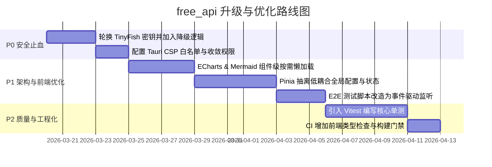

# free_api 项目全景升级排查与健康度实测报告

> **审查基线**：Tauri 2.0 + Vue 3 + Rust 桌面级自主系统 Agent 平台
> **实测环境**：Node.js `v26.7.0` | npm `11.19.0` | macOS (Apple Silicon)
> **构建基准实测**：`vue-tsc --noEmit` (~2.9s) + `vite build` 2845 模块 (~5.92s) = **完整构建总耗时 8.84s**

---

## 💡 核心结论摘要：关于构建升级与“快乐度”的实测解答

1. **你的直觉完全准确：当前完全不需要为了提速去冒险升级 Vite 8 或 TS 7**。
   - 工业界宣传 Rolldown 提速 10~30 倍的场景，是针对数万模块、构建耗时 5~10 分钟的巨石工程；
   - 本项目当前 2845 个模块，Vite 6 完整打包只需 **5.92 秒**，开发环境 HMR 热重载仅数十毫秒；即使换用 Rolldown 缩减至 2 秒，为节省 3 秒却要承担跨大版本插件不兼容与构建配置断裂风险，得不偿失。
2. **真正的体积与冷启动瓶颈**：
   - 现场构建实测发现打包产物中存在两个超大型依赖：`vendor-mermaid.js` (**3.41 MB**) 与 `vendor-echarts.js` (**1.13 MB**)；
   - 比起升级打包器，对这两个重型模块做**路由/组件级动态懒加载**，对桌面端冷启动内存和速度的提升远更显著。

---

## 🚨 一、安全性升级清单（P0 最高优先级）

### 1.1 TinyFish API Key 凭据入库处理（渐进降级方案）
- **位置**：`src-tauri/src/agent/web_search.rs:24`
- **现状**：代码中硬编码了 `DEFAULT_TINYFISH_API_KEY = "sk-tinyfish-UDFwFLn_4R2v..."` 作为免配置兜底。
- **改造建议（平衡安全性与开箱可用性）**：
  1. 立即在 TinyFish 平台轮换/重新派发该 Key，若仓库计划开源，需使用 `git-filter-repo` 清洗历史提交；
  2. **避免一刀切硬拔导致新环境瘫痪**：将默认 Key 改为构建期环境变量（CI/打包参数注入），开发环境未配置时，优雅降级到免 Key 搜索源（如 DuckDuckGo HTML / Wikipedia / Bing RSS），保护开箱即用体验。

### 1.2 Tauri 内容安全策略 (CSP) 补齐
- **位置**：`src-tauri/tauri.conf.json` -> `app.security.csp`
- **现状**：配置为 `null`，无任何来源白名单约束。
- **改造建议**：配置基础白名单 CSP（限制 `default-src 'self'; script-src 'self'; connect-src 'self' https: ipc:`），防止潜在的 XSS 与未授权外部调用。

### 1.3 Capabilities 权限作用域收敛
- **位置**：`src-tauri/capabilities/default.json`
- **现状**：`windows: ["*"]` 通配所有窗口，`fs:allow-read-file` 未指定限定目录 scope。
- **改造建议**：将 `windows` 明确绑定到 `main` 窗口，文件读取权限通过 `scope` 限制在用户数据目录与项目允许目录内。

---

## 🏗️ 二、架构与性能升级清单（P1 架构治理）

### 2.1 监听与唤醒机制升级（事件驱动 vs 忙轮询）
- **Rust 后端（现状：优秀 ✅）**：
  - 大量采用 `tokio::sync::watch`（任务中断通道、阶段审查门控）、`broadcast`（全局 512 深度总线推前端）与 `mpsc`；
  - 协程空闲时零 CPU 占用，事件到达微秒级唤醒，已达现代并发最佳实践。
- **E2E 测试脚本（现状：初级 ⚠️）**：
  - `test/e2e/live-agent-smoke.e2e.mjs:145` 等处存在 `while (!existsSync) await setTimeout(1000)` 1 秒忙轮询；
  - **升级建议**：利用 Node 20+ 内置的 `fs.promises.watch()` 实现事件驱动等待，报告文件落盘瞬间挂起解除，消除等待期无效空转。
- **Rust 侧 8 处 sleep 轮询残留**：
  - `watch_engine.rs`（3处）、`scheduler.rs`（2处）等存在 `sleep` 轮询；对延迟敏感的调度流建议迁移为 `tokio::sync::Notify`。

### 2.2 前端状态管理渐进切片（采纳审查推演建议）
- **位置**：`package.json`（已引入 pinia） vs `src/stores/`（当前为空） vs `src/composables/useAgentSession.ts`（2012 行）
- **改造原则（严禁一次性大爆炸重写）**：
  1. **第一阶段**：优先将低耦合状态（如模型列表配置、UI 会话历史分页元数据、全局运行时布尔标志）抽离并迁入 Pinia Store；
  2. **第二阶段**：主 Agent 会话交互与流式解析维持组合式函数（Composable），确保多智能体事件流的响应式连续性不被破坏。

### 2.3 超大单文件（上帝模块）分治
- 全库超过 2000 行的 8 个重点文件：
  1. `src-tauri/src/agent/child_reviewer.rs` (3048 行)
  2. `src/views/RoleManagerView.vue` (2872 行)
  3. `src/components/ProjectWorkspace.vue` (2726 行)
  4. `src-tauri/src/agent/loop_runner.rs` (2366 行)
  5. `src-tauri/src/agent/main_loop.rs` (2250 行)
  6. `src/components/agent/AgentComposer.vue` (2121 行)
  7. `src-tauri/src/agent/checkpoint.rs` (2067 行)
  8. `src/composables/useAgentSession.ts` (2012 行)
- **建议**：在日常业务迭代中按功能子域拆分为独立子模块，不搞休克式大重构。

---

## 📦 三、依赖与工具链升级评估（P1~P2）

| 工具 / 依赖 | 当前版本 | 最新版本 | 升级建议与风险评估 |
|---|---|---|---|
| **Vite** | `^6.0.3` | `8.2.2` | **暂缓升级**。当前打包只需 5.9 秒，本地体验已极佳；升级 Rolldown 收益仅数秒，存在配置与插件兼容风险。|
| **TypeScript** | `~5.6.2` | `7.0.2` | **严禁升级至 TS 7**。TS 7 改用 Go 原生二进制重写，Vue 官方工具链 `vue-tsc` 与 Volar 尚未适配，会导致 `.vue` 文件的宏类型推导完全失效；建议最高升至 5.8 补丁版。|
| **Pinia** | `^3.0.4` | `4.0.3` | 结合状态管理拆分计划平滑引入，不作为单独动作。|
| **Rust 工具链** | Edition 2021 | Edition 2024 | 可在后续版本演进中按官方迁移指南平滑切入 Rust 2024。|

---

## 🧪 四、测试体系与工程化建设（P2 质量基建）

1. **前端单元测试补齐**：
   - 目前前端为 **0 个单元测试**，完全依赖耗时数分钟的 E2E 真实大模型用例；
   - **建议**：引入 `vitest`，为 `src/utils/`（文件处理、数据解析）与基础 hooks 提供毫秒级单测。
2. **Rust 错误传播治理**：
   - 全库统计有 841 处 `unwrap`（热点在 `child_reviewer.rs` 131 处、`projects.rs` 66 处）；生产路径建议改用 `?` 配合 `anyhow` / `thiserror` 传播，杜绝未捕获 panic 导致桌面端静默崩溃闪退。
3. **CI 流水线补全**：
   - 目前 `.github/workflows/rust.yml` 仅运行 Rust build & test；建议增加前端 Job：`npm run build`（包含 `vue-tsc --noEmit` 类型门禁）。
4. **代码规范化**：
   - 项目内引入 ESLint 与 Prettier 配置文件，统一团队与自动化工具代码风格。

---

## 📅 分阶段实施落地路线图

