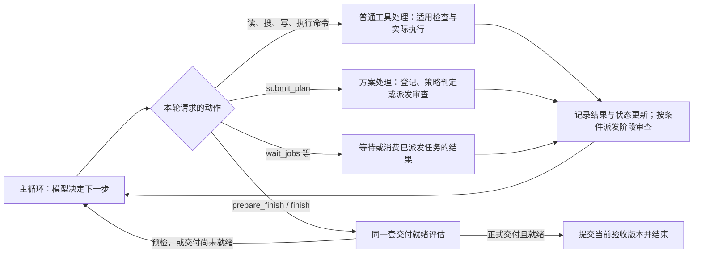

# Agent 检测、审查与交付流程核查

核查日期：2026-10-16（北京时间）

代码快照：`main` / `80949d9`

性质：流程说明与只读审计。本报告不增加门禁，不修改运行代码、会话状态或历史数据库。

后续状态：第 1–13 节保留上述快照的审计发现；三处缺陷已在本地工作区修复并完成回归，见第 14 节。原始审计与后续实施分开记录。

## 1. 先看结论

当前结构可以概括为：**主循环调度，工具执行前守操作边界，执行后记账，交付前统一评估，凭当前版本的验收收据提交完成。**

之前删除的自动消费点逐项裁决、TODO 关键词意图判断、证据命令词形判断及入口调查清单强制核销，确实减少了几种已确认的误拦来源。

但“交付顺畅”和“审查结论可靠”是两件事。当前还存在需要处理的接缝：

| 项目 | 核查结果 | 证据强度 |
|---|---|---|
| 后台 shell 任务归属 | 用 session_id 查询 run_id 索引的检查点，失败后继续用 session_id 登记 parent_run_id，导致本轮查询遗漏任务 | 源码与最新运行数据库相互印证，已确认 |
| details 与验收范围 | details 会保存和展示，但没有独立进入终审正文和验收指纹；正文承担实质交付内容时存在漏审风险 | 代码事实已确认，影响取决于正文承担的职责；未做付费模型实验 |
| read_only 输入覆盖分类 | 输入中自填的 read_only=true 能优先覆盖已知写动作分类，而实际文件工具仍按 write 执行 | 静态调用链确认；未进行写入逃逸实测，也不推断所有安全措施都被绕过 |

第一项优先修复任务归属。后两项应分别明确验收正文和可信工具属性的来源，修复已有数据流，而不是再增加一套让模型填表的规则。

## 2. 先分清：运行状态、内部动作、检查项

**此前把它们画在一条线上，容易让人误以为任务必须依次经过所有检查阶段。这种画法不准确。**

- **运行状态**：宿主现在在做什么，例如调用模型、执行指令、等人、恢复。代码的 `AgentRunState` 确实有 11 个枚举值。
- **内部动作**：模型这一步请求宿主做什么，例如提交方案、等待子任务、预检交付、正式交付。可以把它们理解为内部工具；实现上有专门的协议处理器，不全部走普通外部工具派发。
- **检查条件**：这个动作在当前记录下能否执行或提交。例如写入前查权限，交付时查未完成 TODO。检查不是独立运行状态。

第 8 节的“11 类交付检查”是按职责归并的说明，**与 11 个运行状态没有一一对应关系，数量相同只是巧合**。入口分流、方案讨论、实施、验证、交付是理解任务的业务阶段，也不是另一条固定必经的运行状态序列。

### 2.1 按动作看调度，而不是画成必经关卡

图表示动作分支，省略了入口初始化、人工等待及失败/取消出口，不是完整的状态迁移图。TODO、契约、验证申报是可随指令提交的状态更新，不是必须单独调用的工具；在交付评估前也会处理适用的更新。

退回主循环表示仍可补正，不代表无上限重试。预算、中断、不可恢复的审查通道故障及明确申报未完成，都有结束路径。

主入口：[main_loop/mod.rs](/home/w/文档/free_api/src-tauri/src/agent/main_loop/mod.rs:232)。工具阶段：[loop_runner/mod.rs](/home/w/文档/free_api/src-tauri/src/agent/loop_runner/mod.rs:109)。

### 2.2 按任务发生的时机看：什么时候查什么

| 时机或动作 | 当时实际做什么 | 后续还要核对什么 |
|---|---|---|
| 接到任务 | 绑定工作区、基线；入口分流产生并持久化先验 | 分流不证明方案正确，也不证明任务完成 |
| 探索、拆解工作 | 读源码、搜索；可建立和更新 TODO、契约等记录 | 阅读次数与 TODO 数量不证明理解充分 |
| `submit_plan` | 处理方案摘要、目标与证据；按模式/策略登记、派审或等人工审批 | 批准的是准备怎么做；没有验收尚未完成的代码 |
| 读写、命令执行 | 参数检查；写操作适用方案、路径、范围等保护；执行后记录结果和副作用 | 执行成功不等于目标行为正确 |
| 有一批变更或 TODO 完成 | 满足启用条件时派发阶段审查，之后消费审查结果 | TODO 完成不等于阶段审查通过；Auto 当前不派发新的阶段审查 |
| 运行验证、提交验证记录 | 宿主取得命令结果；模型可引用步骤申报 verified 或说明 waived | 引用的时序有效，不等于测试语义充分；新写入会使旧验证过时 |
| `prepare_finish` / `finish` | 对当前材料统一汇总第 8 节的适用检查；需要时执行验证和终审 | 预检只给就绪结果；正式交付还要提交当前收据 |
| 正式提交 | 核对收据、版本、中断，事务保存完成结果 | 数据库提交成功后才通知完成 |

这张表是常见工作顺序，不要求所有任务都提交方案、派阶段审查或调用模型终审。只读问答、临时文档和复杂代码修复会走不同分支。

## 3. 几种状态各自管理什么

### 3.1 真正的 11 个运行状态

| 状态 | 含义 | 常见到达方式 |
|---|---|---|
| `Idle` | 尚未启动 | 运行机刚建立 |
| `Preparing` | 准备运行环境 | Start |
| `Planning` | 模型正在决定下一条指令 | RuntimeReady、BeginPlanning、RetryPlanning |
| `Executing` | 宿主正在处理指令 | InstructionReady、收到人工答复或救援指令 |
| `WaitingForHuman` | 等待人工输入 | WaitForHuman |
| `Recovering` | 模型请求或工具失败后的恢复 | PlanningFailed、ToolFailed |
| `Rescuing` | 请求外部救援指令 | RescueRequested |
| `Finalizing` | 收尾通知与结果整理 | BeginFinalizing |
| `Succeeded` | 已成功结束 | Succeed |
| `Failed` | 已失败结束 | Fail |
| `Cancelled` | 已取消 | Cancel |

**这里的 Planning 不是专指“制定技术方案”。** 模型决定去读一个文件、等子任务、提交方案或申请交付，都会处在这类运行状态中。因此 `Planning → Executing → Planning` 会重复很多次，`submit_plan` 与 `finish` 都可能是某次 Executing 正在处理的指令。

也不要把 `Finalizing` 当成“终审员正在审”。当前成功路径是在完成数据库提交后发出 BeginFinalizing，再通知完成。运行标签粒度和内部审查工作不是同一层。

迁移函数目前明确保护终态及人工答复的部分来源条件，多数事件直接设置对应状态；不能据此声称已有覆盖全部合法前驱的严格迁移矩阵。源码：[run_state.rs](/home/w/文档/free_api/src-tauri/src/agent/run_state.rs:142)。

### 3.2 其他记录不是这 11 个状态的重复

| 状态或记录 | 回答的问题 | 实现定位 |
|---|---|---|
| AgentRunMachine | 当前正在准备、规划、执行、等人、恢复、收尾，还是已成功/失败/取消？ | 上表 11 态；运行生命周期快照 |
| AgentCheckpoint / AgentPhase | 崩溃后从哪一步恢复？有没有已确认指令、未确定结果的调用？ | [types.rs](/home/w/文档/free_api/src-tauri/src/agent/checkpoint/types.rs:22)，5 态：CallLlm / RunTool / WaitUser / Done / Failed |
| PlanPhase / 审查回执 | 方案是否在探索、审查、等待批准或已批准？哪些审查问题还没处理？ | [types.rs](/home/w/文档/free_api/src-tauri/src/agent/checkpoint/types.rs:67)，4 态：Exploring / Reviewing / AwaitingApproval / Approved；问题另有记录 |
| ChangeVerification | 最近一批变更是否验证或说明了豁免理由？ | [change_verification.rs](/home/w/文档/free_api/src-tauri/src/agent/change_verification.rs:13)，状态、证据引用与写入后的时序校验 |
| FinalizationReceipt | 这次准备交付的版本是否满足验收条件？ | [finalization.rs](/home/w/文档/free_api/src-tauri/src/agent/finalization.rs:110)，冻结材料版本、验证结果、审查结果、阻塞项与交付载荷 |

这些不是五套平级的总控状态机。运行状态负责生命周期，checkpoint 负责恢复，方案与审查负责子流程，验收收据负责最终提交条件。

例如“任务执行中、方案已批准、刚产生新写入所以验证待更新、旧阶段问题已经解决”是一组合理状态。

收据就绪也不等于数据库已经提交成功；正式完成仍需要最后的短事务成功。

### 3.3 TODO、方案、契约、验证分别是什么

| 记录 | 管什么 | 何时可以出现或更新 | 不能代替什么 |
|---|---|---|---|
| TODO | 执行工作的待办与进展 | 开始探索时可建；方案、实施、审查反馈后均可更新 | 不能代替方案批准、验证或终审 |
| 提交的方案 | 做法、目标范围与来源证据 | `submit_plan`；后续有理由可修订 | 不能代替实际改动 |
| 审查契约 | 已登记的审查义务及证据/豁免申报 | 建立后按条目更新；调查参考不会自动成为契约 | evidenced 是申报，不是审查通过 |
| ChangeVerification | 最近副作用后的验证状态 | 写入后取得新证据，再更新 verified/waived | 不能用旧步骤证明新变更已验证 |

所以“开始阶段有 TODO，方案阶段也有 TODO”是合理的，但并不存在“建立 TODO 就进入方案已批准”的迁移。当前主循环先记录工具副作用，再应用 TODO/契约/验证更新，然后判断阶段审查是否触发，随后才处理本轮交付评估。定位：[状态更新](/home/w/文档/free_api/src-tauri/src/agent/main_loop/mod.rs:1784)。

例子：先列“定位问题、修复、验证”，定位完成后更新 TODO；提交方案获批后实施；测试失败又补一个待办；修正并验证后再申请交付。TODO 在贯穿记账，不是只在开头出现。已有审查发现也不能靠下一轮 TODO 清单漏掉它来静默消除。

### 3.4 三种审查各审什么

| 审查 | 触发处 | 核心对象 | 通过后意味着什么 |
|---|---|---|---|
| 方案审查 | 适用的 `submit_plan` 路径 | 题面、根因解释、拟采用的做法与证据 | 允许按这份方案继续；没有证明最终实现正确 |
| 阶段审查 | 工具执行后的条件触发 | 当前一批实际变更与中间态问题 | 本次中间检查没有未解决的适用阻塞；不是最终验收 |
| 交付终审 | `prepare_finish` / `finish` 的评估内部，且需要模型终审时 | 最终 diff/产物、题面、契约、验证与已有问题 | 本次审查结果可被验收接受；还要满足机械检查和正式提交条件 |

Auto 下 `submit_plan` 可能只登记方案并返回策略预检，不派审查，也不把 PlanPhase 改为 Approved；后续写入继续受适用策略约束。显式交叉审查或审批路径另行处理。不能把“方案已提交”“审查已派发”“方案已批准”当成同一件事。

## 4. 入口：确定工作区与分流

### 4.1 工作区和任务起点

宿主绑定项目目录、会话 tmp、附加目录权限，并保存任务起点 Git 基线。基线用于后续区分任务开始前就存在的未提交内容与之后的差异。

该基线不是完整的“改动作者归属证明”。同一仓库上其他进程在本任务期间产生的变化，仍可能进入材料。不能为隐藏差异而随意重置续跑基线。

### 4.2 入口分流是模型判断

入口模型给出 route、阶段审查方式、终审方式、证据策略及调查参考。判决落 checkpoint；恢复旧 run 时通常沿用，不每步重判。

- 有效的 technical_plan / expert_panel 判决可能要求先提交方案。
- direct 等路线在适用时不触发方案门，但不取消路径权限、参数校验或已有阶段阻塞。
- investigation_questions / required_evidence 现在只是可修正的参考，不自动成为新增验收清单。
- 入口超时或异常会保存带 fallback 标记的兼容默认。默认字段不能被解读为模型已经确认任务复杂。
- 当前自动模式下，fallback 的本会话 tmp 文件写入可按物理边界豁免方案门；工作区写入、显式审批和有效方案判决保留原规则。

适用性函数：[pre_write_plan_required](/home/w/文档/free_api/src-tauri/src/agent/plan_gate/mod.rs:17)。tmp 判定使用真实路径边界，也考虑新建路径和符号链接；不依赖文件名包含“测试”“报告”等文字。

### 4.3 入口判断如何修正

已有 request_retriage、带 revision_reason 的方案修订、范围扩展、审查打回与人工仲裁。不是所有修改都自动重新分流；主动复核存在次数等限制。

这是一项残余边界：模型没有主动意识到先验错误时，旧判决仍可能持续影响执行。

## 5. 每一步：模型输出到工具执行前

### 5.1 JSON 与动作契约

模型输出先经过 JSON 提取/修复、结构转换、可执行入口检查和有限兼容归一。

- 外层须是可解析的指令对象；正文字符串可以包含 Markdown。
- 不能把只有进度说明、没有动作的对象静默当成可执行工具。
- 部分独立状态动作别名会被归一；夹带的工具动作可能被丢弃而不执行。
- 实际入口仍有防御性协议检查，兼容归一并不代表任何形状都能执行。
- 新轨迹分别记录 declared_action 与有效 action，区分输入声明和宿主缺省。

本次涉及的默认值是 local_file→read，artifact_manager/artifact_store→create_document。需要 write、edit、register_file 时应显式指定，不根据 content 或 path 自动升级成有副作用的操作。

解析入口：[llm_client.rs](/home/w/文档/free_api/src-tauri/src/agent/utils/llm_client.rs:69)。动作解析：[types/mod.rs](/home/w/文档/free_api/src-tauri/src/agent/types/mod.rs:750)。

### 5.2 参数预检先于业务门禁

检查必填字段、类型、范围和已知参数矛盾。失败应说明：哪一层拒绝、具体字段有何问题、工具尚未执行。

例如 read 动作却携带已知写入字段，不会自动改成 write，而是在预检阶段报告矛盾。

预检位置：[loop_runner/mod.rs](/home/w/文档/free_api/src-tauri/src/agent/loop_runner/mod.rs:156)。具体契约：[input_validation.rs](/home/w/文档/free_api/src-tauri/src/agent/tools/input_validation.rs:65)。

### 5.3 过程层仍有拦截

前面讨论的“11 类”只统计交付阶段，整个 Agent 的检查不止这些：

| 检查 | 触发与行为 | 当前边界 |
|---|---|---|
| 相同调用重复失败 | 同工具、动作、参数指纹，且错误摘要被识别为确定性失败时，阻止原样重发 | “确定性”的识别仍含错误文本词匹配，并非所有场景都能证明重试一定无效 |
| 重复读取 | 同工具、路径、读取窗口，内容指纹未变，第 3 次读取时拒绝 | 不同窗口和内容变化会放行；超大文件只取头部内容作指纹，是有限覆盖 |
| 批发派发熔断 | 近期连续批量格式失败后，暂时要求单发 | 是过程限制，不是任务质量证明 |
| 并行分支上限 | 当前最多 4 路可识别的纯读；含执行/写入/未知分支时最多 2 路 | shell 的“看起来只读”不等于自动适用纯读扩展额度 |
| 步数、token、看门狗 | 超预算、长时间无返回等触发失败或恢复 | 是资源边界，不证明任务内容有问题 |

重复调用逻辑：[context/types/mod.rs](/home/w/文档/free_api/src-tauri/src/agent/context/types/mod.rs:1056)。重复读取：[同文件](/home/w/文档/free_api/src-tauri/src/agent/context/types/mod.rs:679)。

本报告没有新证据证明这些过程限制在最新一轮造成了有效取证丢失，因此不主张仅凭感觉全部删除；但它们仍应接受“防什么事故、实际收益、成本、误伤”四问。

## 6. 写操作：方案门、权限和执行保护

### 6.1 写前方案门

宿主先分类当前调用是否可能写入，再计算方案门是否适用。

- 显式方案审批模式要求人工批准。
- 有效入口判决要求技术方案时，执行 submit_plan 及适用审查流程。
- 破坏性动作、多文件扩散等机械地板会要求更严格路径。
- 旧 checkpoint 没有判决时，使用既有机械兜底规则，不能与 fallback 临时目录例外混为一谈。
- 已有阶段 blocking 问题独立检查；方案门豁免不自动清除这些问题。

方案内容检查、策略评估和审查员调度分别负责不同事情。审查分数、具体 blocking、是否有结构化方案、是否回收审查结论也并非一个字段。

### 6.2 权限与高危操作

在通用本地工具执行前，还有：

- 已知越界写入的资源作用域检查。
- 部分敏感 shell 访问的明确确认流程。
- 破坏性 Git 命令按目标、脏状态、本会话写入台账和人工确认指纹判定。
- 原生文件工具的路径 canonicalize、工作区/本会话 tmp 围栏。
- 文件修改的读取基线、目标唯一性、并发哈希等具体工具约束。

实现：[dispatch_local.rs](/home/w/文档/free_api/src-tauri/src/agent/loop_runner/dispatch_local.rs:25)、[path_guard.rs](/home/w/文档/free_api/src-tauri/src/agent/path_guard.rs:142)。

这些保护的覆盖范围不同。受控文件 API 的路径围栏，不能直接被理解成任意 shell 和任意外部 MCP 都处于同一文件系统沙箱中。

### 6.3 执行与恢复

对需要恢复审计的调用，执行前保存 pending；安全读操作、幂等操作、需要探测或人工核对的未知副作用，采用不同恢复策略。

调用完成后记录输出、步骤结果和副作用。新的写入会使旧验证状态失效。shell 还通过工作区差值补充变更记录，但差值也不是完整的作者归属证明。

## 7. 阶段审查、后台任务和中断

### 7.1 阶段审查不是每步固定执行

它受入口判决、配置、方案批准状态、预算、在途审查和未解决问题共同控制。当前 Auto 模式会跳过新阶段审查触发，但已经存在的阻塞问题仍有独立处理路径。

审查结果区分：中间态也成立的 blocking 会阻止后续写入；仅针对最终状态的问题记录到终审材料。

位置：[stage_review/mod.rs](/home/w/文档/free_api/src-tauri/src/agent/stage_review/mod.rs:1)。

### 7.2 后台任务要关联同一个 run

后台任务登记 parent_run_id，等待、回收和交付前检查也应使用相同 run_id。job_id 能定位具体任务，session_id 则代表会话，三者不能互换。

显式 background:true 的 shell 日志实时追加；同步命令超时后转后台的路径，目前提示日志在结束后写入。读取不到后者的日志，不能据此直接判断命令没运行。

### 7.3 停止与重试

模型请求、工具等待、交付评估和最后提交附近都有中断检查。停止信号、失败请求和预算耗尽有各自的结束路径。

工具副作用若已经发出，取消等待不等于撤销已发生的动作；恢复时应依据 pending 和实际结果处理。

还有连续门禁拒绝的降级停止逻辑。它以未完成结束并保存现场，不应被解释成重试多次后自动验收成功。

## 8. 交付：统一评估的实际顺序

prepare_finish 与 finish 共用 [evaluate_completion](/home/w/文档/free_api/src-tauri/src/agent/finalization/evaluate.rs:104)。

1. 构造当前提交载荷，对已知残缺 finish 外壳做窄口径结构恢复。
2. 汇总待办、契约、证据引用、后台任务、阶段阻塞、scope 和方案目标对账。
3. 比较材料、作用域、契约及验收状态指纹，判断是否可复用就绪收据。
4. 对适用的新变更执行契约验证命令/脚本，并按条件执行自适应验证。
5. 工具无法运行或没有可推导命令时，记录未验证/豁免原因并移交审查；实际命令失败则报告原始诊断。
6. 汇总适用终审材料，调用终审或进入明确的免模型审查路径。
7. 再检查后台任务、材料变化和中断信号。
8. 生成收据；阻塞项为空、验证状态可接受、审查被接受时才就绪。
9. 正式 finish 再核对收据及中断，提交数据库短事务，然后通知前端完成。

预检就绪不是完成。预检未就绪也不一定是“代码有错”，可能只是字段、证据、任务归属或审查通道存在问题。

### 8.1 交付阶段的 11 类检查

按职责归并，并非 11 个必须顺序经过的状态：

| # | 类别 | 数据从哪里来 | 何时核对、适用时如何处理 |
|---|---|---|---|
| 1 | 未完成 TODO | 探索、方案、实施和反馈期间的 TODO 更新 | 交付评估时有 pending/in_progress，不能直接申报完成 |
| 2 | 审查契约 | 先前登记及持续更新的义务 | 交付评估核对完整契约；未闭合或当轮才新建，先处理 |
| 3 | 代码证据位置 | 取证过程与提交的引用 | 交付评估核对可机械解析的位置；位置存在不证明结论正确 |
| 4 | scope | 核准范围、范围扩展与实际副作用 | 写前有适用边界检查，交付时再对实际结果对账 |
| 5 | 方案目标对账 | submit_plan 的目标、实际改动与产物 | 交付时检查零交集等不一致；不是提交方案时预先验收代码 |
| 6 | 验证 | 写入台账、后续验证步骤、验证申报及宿主实测 | 写入后更新，交付时检查或执行适用验证；失败/未解决需补正 |
| 7 | 阶段阻塞 | 中途已消费的阶段审查发现 | 适用的写前门及交付评估；申请 finish 不会自动清除旧问题 |
| 8 | 终审 | 本次评估的模型审查或明确的免模型路径 | 交付评估内部处理；具体 blocking 会拦，通道故障不是通过 |
| 9 | 后台任务 | 派发时登记的 child/job 状态 | 运行中等待/回收，交付时查在途；归属缺陷见第 10 节 |
| 10 | 版本与收据 | 本次评估材料和状态的指纹 | 预检、正式交付及最后提交核对；旧收据不得覆盖新版本，details 例外缺陷另述 |
| 11 | 停止/替换任务 | 宿主中断信号 | 多个执行点及最后提交检查，不是只在交付末尾检查 |

**前面持续积累记录，交付时汇总核对。** 例如 TODO 完成、测试完成、阶段审查完成可以发生在不同步骤，最后都成为本次交付评估的输入。它们不是要让 Agent 再走 11 次状态迁移。

另有评测 oracle 的宿主阶段判分进度检查，仅在存在活动评测 oracle 时适用。数据库写失败等基础设施错误另行处理，不计为业务验收义务。

### 8.2 终审何时跳过、何时真正调用模型

- mechanical_only 且无产物异常时，可以跳过 LLM 终审。
- 本轮没有新增写入副作用、没有本轮 tmp 产物、没有异常时，按只读问答跳过 LLM 终审。
- 因而界面“成功”或内部机械通过，不能被解读成“独立审查员已经审过全部回答”。
- 需要模型终审时，材料包括适用的 diff/产物、任务与方案边界、契约声明、宿主验证、具体阶段问题和工具证据索引。入口调查单作为参考，不再自动要求逐条核销。
- 审查员可使用受限只读取证工具及本会话输出原文回查。
- 判决 JSON 必须能正确解析，真实 blocking 不会因 verdict 写成 passed 而自动消失。反之，拒绝却不给 blocking 是格式错误，进入既有修正路径。
- 当前终审接受主要依据具体阻塞项和通道状态；score 本身不是代码正确性的机械判据。

位置：[finish_diff.rs](/home/w/文档/free_api/src-tauri/src/agent/reviewer_gatekeeper/finish_diff.rs:195)、[verdict_parse.rs](/home/w/文档/free_api/src-tauri/src/agent/reviewer_gatekeeper/verdict_parse.rs:20)。

### 8.3 证据究竟能证明什么

| 证据 | 宿主能直接核对的部分 | 仍需判断的部分 |
|---|---|---|
| file:line | 文件/位置是否存在、是否能定位 | 是否支持结论、是否覆盖所有相关分支 |
| step_N | 引用步骤与最近写入之间的时序关系 | 该步骤是否真的验证了目标行为 |
| output_id | 是否能从受限范围取回原文 | 输出是否充分、命令范围是否合适 |
| 命令退出码 | 宿主实际运行后的返回值 | 测试设计和断言是否正确、是否被管道掩盖上游失败 |
| diff/产物 | 磁盘实物、变更、文件大小、部分格式异常 | 需求完整性、运行效果、业务正确性 |
| 审查通过 | 审查通道确实给出可接受结果 | 审查员有无遗漏、误判或共享盲区 |

因此“位置存在”“退出 0”“模型审过”“收据就绪”分别是不同层次的证据，不能互相冒充。

## 9. 最终提交为什么比散落的完成标记清楚

收据绑定当前验收状态。正式提交使用收据中的载荷，构造候选 Done，再将 checkpoint、run trace 和最终 assistant 消息放进同一数据库事务。

- 事务失败：不应出现一处宣布成功、另一处仍在执行的半截状态。
- 事务成功：再更新内存、通知前端完成。
- Markdown 展示使用已提交正文；流式 finish 草稿不直接作为最终交付。
- 旧残缺正文的恢复是结构解包，保留原始记录，不按关键词删代码、证据句柄或尾部括号。

位置：[main_loop/finalize.rs](/home/w/文档/free_api/src-tauri/src/agent/main_loop/finalize.rs:13)、[finalization.rs](/home/w/文档/free_api/src-tauri/src/agent/finalization.rs:217)。

## 10. 当前需要优先处理的接缝

### F1：后台任务 parent_run_id 错绑为 session_id（优先处理，已确认）

**根因链**：

1. [local_shell::current_run_id](/home/w/文档/free_api/src-tauri/src/agent/tools/local_shell.rs:853) 调用 `load_checkpoint(db, session_id)`。
2. [load_checkpoint](/home/w/文档/free_api/src-tauri/src/agent/checkpoint/mod.rs:568) 实际按 `WHERE run_id = ?1` 查询。
3. 查不到后，current_run_id 静默返回 session_id；显式后台与同步超时转后台两种路径都调用它。
4. job_engine 的等待、回收和 has_running_jobs 则按真实 parent_run_id 查询。

**最新运行的实际证据**：

- 审查任务 run：`efcee4ae-3bb5-4d63-8982-ec2e7a6eeb19`。
- 会话：`3cb52d4c-b2c6-49d3-aa8b-9ee3aeaf89bb`。
- 三个后台 shell job 的 parent_run_id 全部为会话 ID，而不是运行 ID。
- 按真实 run_id 查询对应后台记录：0 条；按该 session_id 作为 parent_run_id 查询：3 条。
- 第 11 条步骤的 wait_jobs 返回：“当前没有已派发的后台任务”，但后台测试实际存在，并留下两份 1104 项通过的日志。

**影响**：等待、自动回收、停止清理和交付前在途检查可能看不到这些任务。该轮第三次重复测试后来已发起取消；不能据此说该轮一定在仍有活任务时错误交付，但任务归属缺陷本身已成立。

**局部修复方向**：由宿主执行上下文明确传入真实 run_id，登记与查询共用同一个 ID。不要让模型填写，也不要靠“最近一个 session”猜归属。历史记录如何关联须单独核实，不在本报告中批量改库。

**用一个例子理解**：会话是“这个聊天窗口 S”，一次运行是“窗口内第 R 轮任务”。工具把测试登记成“属于 S”，等待器却查“属于 R 的测试”。测试确实在跑，但等待器看到空集合，于是回答没有任务。让模型再调用十次 wait_jobs，也修不好这两个 ID 的错位。

这解释了本轮已出现的错误等待回执，也可能影响相同查询口径的回收/收尾；**它不单独证明“点停止后一定自动重启”**。后者仍需停止时点、运行事件和取消传播证据，不能用一个归属 bug 包办解释全部历史现象。修复后应以合成 run/session 验证登记、等待、回收、在途检查的 ID 一致，并分别测试显式后台和超时转后台两条路径。

### F2：details 不在终审正文和验收指纹中（条件性漏审风险）

**实现事实**：

- [evaluate_completion](/home/w/文档/free_api/src-tauri/src/agent/finalization/evaluate.rs:123) 从请求载荷中只取 summary。
- [acceptance_fingerprint](/home/w/文档/free_api/src-tauri/src/agent/finalization/evaluate.rs:48) 绑定 summary 与若干状态，没有绑定 details。
- 终审调用传入的交付文本也是 summary。
- 收据复用时，会把整个新的 request_payload 填回 finish_payload。
- 正式提交及界面又会保存、展示 details。

所以，summary、diff 和其他状态都不变时，改变 details 本身不足以使该收据指纹失效；即使重新调用终审，details 也没有独立作为本次正文传入。

**适用边界**：如果 details 只是附加说明，而实际报告已落盘并纳入审查材料，影响有限；如果实质报告或关键结论只写在 details，就可能出现“验收短摘要、交付长正文”。只读问答本来就有免模型审查路径，也不能把它混同为所有任务的终审故障。

此前统一排版提示已经鼓励长说明放 details，因此这个接口约定值得同步澄清。不能只让模型“记得把正文落盘”来承担全部一致性责任。

**局部修复方向**：先定义本次交付正文的唯一组装方式，再让终审材料、验收指纹与正式提交共用；正文变化时按需要重核正文，不因排版变化无差别重跑全部测试。无需新增逐项填表义务。

**触发例子**：第一次预检提交 summary=“检查已完成”、details=“发现问题 A”；获得就绪收据后，保持源码、状态和 summary 不变，正式 finish 的 details 改成“没有发现问题”。现有验收指纹不会仅因这处 details 变化失效，复用分支又用新载荷替换收据正文。于是“拿去验收的结论”和“最终显示的结论”可能不一致。

这是同一份交付内容在几个入口中取值不一致，和 Markdown 样式无关。此前正文解包/展示修复解决了残缺 JSON 外壳与误删字符，但**没有把 details 同步纳入所有验收输入，这部分确实还没修完整**。目前确认的是源码路径；上述改正文场景尚未用隔离端到端测试执行。回归应验证 details 改变导致验收版本改变，且终审实际收到完整组装正文；不需要调用付费模型，可以用审查替身记录入参。

### F3：输入自报 read_only 能覆盖已知写动作分类（静态确认，待隔离实测）

位置：[has_read_only_flag](/home/w/文档/free_api/src-tauri/src/agent/dispatcher/mod.rs:33)、[is_write_or_side_effect_tool](/home/w/文档/free_api/src-tauri/src/agent/dispatcher/mod.rs:93)。

目前先检查输入中的 read_only/readonly，包括参数和部分 metadata；命中后直接返回“非写操作”，然后才进入已知 local_file 动作判断。

例如 local_file + action=write + content，同时自带 read_only=true：

- 分类器可返回非写，主循环的方案门及部分写操作前检查依赖这个分类。
- 原生工具仍接收到 write；额外的 read_only 字段不会把执行动作降为 read。
- 底层路径围栏、文件并发检查等仍可能生效，因此不能泛化成任意越界写都成功。

这是“声明只读”和“宿主确认只读”混为一谈。与上一轮报告声称的“外层 read、内层 delete 就会执行 delete”不是同一个问题。

**局部修复方向**：已知原生工具按有效动作及契约分类，不接受调用参数覆盖已知写动作。未知外部工具的可信只读元数据，应明确来自宿主管理的工具定义，而非模型任意自填。先用隔离临时文件回归分类和执行一致性，再实施修复。

**触发例子**：一条指令同时说“action=write、content=新内容”和“read_only=true”。执行工具听前者，照 write 处理；上层分类器先看后者，提前认定非写。结果不是工具误执行了隐藏动作，而是上下层对同一条明确写指令的分类不同。

这可能使依赖该分类器的方案门等检查未执行；并不意味着底层权限、路径围栏及所有副作用记录都消失。正确修法是宿主根据可信工具契约与有效动作判断，不要求模型自己填写一份更复杂的风险声明。隔离回归需对比“正常 write”“write + read_only=true”“正常 read”，验证真实派发结果与门禁分类一致；本报告尚未执行该写入复现。

## 11. 还应观察什么，而不是现在继续加规则

1. **过程限制的误伤**：相同错误文本不一定代表环境永远不变；重复读取也不一定无用。当前没有足够事故证据支持全部删除或继续加严。
2. **成功率与成本分开看**：最新审查运行实际完成，但约 27 分钟内重复跑测试、反复等待不存在的日志；其中后台归属错误有明确机制原因，其他操作失误仍需分别归因。
3. **展示截断不能变成执行参数**：最新轨迹有 shell 命令包含“已省略”标记并产生语法错误。缺成功原始响应时，不能唯一判定是模型复制展示文本还是宿主改写；不建议增加一个按这几个字拒绝命令的启发式门，应核对参数来源和完整性。
4. **工作区共享归属**：任务基线及差值能确定变化，不完全确定谁造成变化；本报告不调整基线、不回滚他人修改。
5. **语义审查能力**：最新报告两条具体缺陷判断与代码不符。测试通过和执行顺畅，并不能证明审查员已经可靠识别问题。
6. **状态展示**：应区分输入错误、操作未执行、命令已运行但未验证、审查未完成、验收有具体阻塞、已停止。不能把所有情况只展示成一条“已拦截”。

## 12. 建议的处置顺序

| 顺序 | 工作 | 目标 |
|---|---|---|
| 1 | 修正后台任务真实 run_id 的传递与关联 | 让已有等待、回收、停止和交付检查看见同一批任务 |
| 2 | 明确并统一 summary/details 的验收正文 | 让保存、展示和验收范围一致 |
| 3 | 对只读属性补隔离回归，修正可信来源 | 让分类与实际执行一致，沿用已有写前保护 |
| 4 | 用同类真实任务观察 | 分开记录完成率、错误结论、误拦次数与成本 |

这些属于修复身份、材料和动作契约的接缝，不需要增加新的认知义务清单。

## 13. 本次核查做了什么、没有证明什么

- 阅读当前主循环、工具派发、参数预检、分流、路径守卫、方案门、阶段审查、后台任务、验证、终审及终态提交的相关实现。
- 只读查询实际 SQLite 运行记录与后台任务表，核对最新审查任务的归属和等待回执。
- 读取既有后台测试日志，确认其中的 1104 passed / 0 failed / 10 ignored；此次没有重新跑这些测试。
- 没有调用付费模型，没有修改运行代码、既有工作区文件或数据库，没有停止任何任务。
- 本报告新增的是这份说明文档。没有穷举每个外部 MCP、全部 shell 命令、所有原生工具参数组合和崩溃时序。
- F1 有实际运行证据；F2 的实现边界和 F3 的分类顺序由静态调用链确认，其全部端到端后果仍应使用隔离回归验证。

已有 [Gate Map](/home/w/文档/free_api/docs/gate-map.md) 可作为机制索引，但历史文档中的数字、标签和默认路径须以当前实现为准。

本报告的判断是：**当前交付收口比散落的完成标记清楚，若干误拦已退出；下一步优先修已有链路的身份与材料一致性，保留真实任务观察，不继续堆叠强制提示。**

## 14. 后续修复与验证（2026-10-16）

本节记录本地修复；不改写上面审计时的证据与结论。

### 14.1 已修改的行为

1. **后台归属**：主循环将真实 parent_run_id 传入派发器，经单步、批量和计划树/并行叶子进入 local_shell；显式后台与同步超时转后台都使用该值，删除按 session_id 查 run_id 检查点并回退 session_id 的推测路径。模型参数里的 run_id 不参与归属。
2. **完整正文**：以 summary + details 的同一投影供终审核验并保存聊天正文；与现有实时/历史界面一致，相同的两段只显示一次，保留 Markdown。验收指纹绑定两个原始字段并更新指纹版本，旧就绪收据重新评估；仅改 details 也无法沿用旧收据。正式提交再次核对两个字段，验证披露不重复拼接 details。
3. **只读分类**：移除调用输入 read_only/readonly 及其 metadata 别名的覆盖路径，继续按既有有效动作/工具分类。真实 read 仍归只读，write 不会因自报只读而改变分类；未新增关键词门或模型填表项。

主要实现：[运行上下文传递](/home/w/文档/free_api/src-tauri/src/agent/loop_runner/dispatch_local.rs:189)、[后台工具](/home/w/文档/free_api/src-tauri/src/agent/tools/local_shell.rs:330)、[正文组装](/home/w/文档/free_api/src-tauri/src/agent/finalization.rs:53)、[验收指纹](/home/w/文档/free_api/src-tauri/src/agent/finalization/evaluate.rs:48)、[最终提交](/home/w/文档/free_api/src-tauri/src/agent/main_loop/finalize.rs:13)、[动作分类](/home/w/文档/free_api/src-tauri/src/agent/dispatcher/mod.rs:46)。

### 14.2 回归结果

- `cargo test --manifest-path src-tauri/Cargo.toml --lib -- --skip clipboard`：**1110 passed / 0 failed / 10 ignored / 1 filtered out**。唯一主动跳过项依赖系统剪贴板，其余 ignored 为原有忽略测试。
- `cargo check --manifest-path src-tauri/Cargo.toml`：通过，保留 3 条既有未使用赋值警告。
- `npx vue-tsc --noEmit`：通过。
- `git diff --check`：通过。

新增回归覆盖实际文件写入与读取、输入只读标记、单步/批量/并行/超时转后台的所属运行、真实 wait_for_jobs 回收、同会话不同运行的取消隔离，以及 prepare_finish → finish 中正文变化重新审查、相同正文复用、正式提交拒绝被更换的正文和完整正文落库。审查请求使用本地 HTTP 替身，捕获实际请求以确认审查员收到长正文；不调用付费模型。

测试入口：[派发与后台回归](/home/w/文档/free_api/src-tauri/src/agent/dispatcher/action_contract_tests.rs:63)、[真实验收链回归](/home/w/文档/free_api/src-tauri/src/agent/finalization/evaluate_tests.rs:27)、[落库与正文一致性回归](/home/w/文档/free_api/src-tauri/src/agent/main_loop/finalize_tests.rs:77)。

### 14.3 兼容边界与尚未验证项

- 独立工具调用若没有宿主运行上下文，显式后台请求在执行前返回缺失上下文；普通同步命令仍可运行，但到同步超时时会中止并披露，不能转成没有归属的后台任务。正常 Agent 执行由宿主提供 run_id，不要求模型补字段。
- 历史错绑 job、正在运行的旧进程与已保存正文未批量迁移或重写；未修改真实数据库、Git 基线或任务状态。
- 外部工具继续使用现有分类方法，尚未引入可信只读属性注册表；自行填写只读标记不再成为豁免依据。
- 回归证明本地身份和正文传递的一致性，不证明模型终审的语义判断可靠，也没有证明全部历史停止异常均由后台归属错误造成。
- 需使用包含本次修复的新构建重启应用才会生效。本次不自动重启，不中断正在运行的任务。
