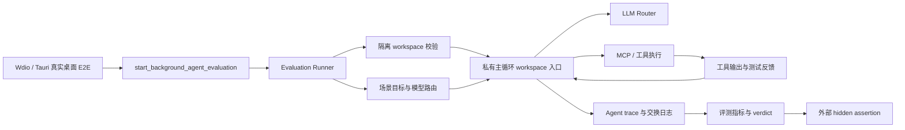

# FreeAPI Agent 真实评测平台、模型调用与多 Agent 路线

**状态：** 已实现单 Agent 真实桌面端评测；尚未实现通用多 Agent 编排。

**最后更新：** 2026-08-27
**范围：** 本文记录已提交的评测控制面、真实模型运行证据、与 Codex/Claude Code 公开机制的边界，以及是否应进入多 Agent 的工程决策。

> 本文严格区分三类内容：**已实测**表示已经经过真实 Tauri/模型/工具链运行；**已实现**表示生产控制面代码已存在；**建议路线**表示尚未实现，不能表述为现有能力。

## 1. 当前结论

FreeAPI 已经具备一条可靠的单 Agent 长程工程执行链：模型在隔离工作区中读取当前义务、修改限定生产源码、运行真实测试、依据测试反馈推进下一阶段，并接受宿主外部 hidden assertion 验收。最新 24 阶段真实运行完成了 76 次模型调用和 77 个工具步骤，24 次计划标题迁移，最终通过全部外部断言；没有 JSON 解析失败、工具失败、重复读取或重复失败动作。

这意味着项目当前最值得继续强化的是**单 Agent 的开放式诊断、跨模块因果推理、压缩遥测和真实补丁质量**，而不是为了“看起来先进”把强依赖写入任务立刻拆成多个并发写 Agent。多 Agent 的首个落点应是受限制的、只读、可独立验证的并行取证；根 Agent 仍然保持唯一写入与最终验证责任。

## 2. 真实评测平台是什么

### 2.1 运行路径

评测不是模拟工具调用，也不是把一段提示词直接发送给模型后人工看回答。它复用生产 Agent 主循环、模型路由、MCP 工具、checkpoint/trace 与 Tauri 桌面启动链路。评测结束后，系统从模型交换日志和运行轨迹中聚合调用次数、解析与工具失败、重复读取/失败、并行度、token、Provider 缓存和上下文水位，并生成可审计报告。

### 2.2 评测场景

| 场景 | 目的 | 写入边界 | 验收方式 |
|---|---|---|---|
| 只读回归 | 测试代码地图、证据链、故障定位与收敛 | 无写入 | trace、报告、人工审查结论 |
| 隔离写入 fixture | 测试真实修代码、测试反馈与补丁质量 | 仅临时 fixture 的 `src/` | 可见测试 + 外部 hidden assertion + 受保护文件不变性 |
| 24 阶段长程收敛 | 测试长期状态维护与顺序闭环 | 每阶段只允许改对应 `src/stage-XX.mjs` | 24 个阶段契约、输入不变性、静态受保护文件完整性 |

隔离写入评测的 workspace 必须是已 canonicalize 的绝对目录，并且必须位于项目 `test-artifacts/` 之下。写入场景没有隔离 workspace 时会被拒绝启动；它不会回退到主项目目录。普通 UI/普通 Agent 入口仍按原工作目录运行，评测通过私有 workspace 主循环入口实现隔离，不使用全局 `chdir`。

## 3. 模型如何被真实调用

后台评测由桌面端 Tauri 命令启动，调用方提供选定模型的 UUID，并将同一 UUID 固定用于 reasoning、execution 与 vision 三条路由。若调用方未要求具名 routing preset，后台评测保留这个选择，不让旧预设覆盖模型，避免测试实际跑到另一模型或缓存被错误分账。

评测主循环与普通会话的区别只在于评测拥有更长的受控运行窗口和暂态传输重试策略：后台评测对可重试 LLM 传输错误最多进行 20 次有界退避；普通会话维持较短重试。配额、鉴权、schema、路径或确定性工具错误不会被原样盲重试。工具失败会作为下一轮模型的反馈，要求模型改变参数、路径或方案。

| 层次 | 当前行为 | 不做什么 |
|---|---|---|
| 模型路由 | 固定调用方选择的模型 UUID | 不在无请求时改写为旧 preset |
| LLM 暂态错误 | 后台评测最多 20 次有界重试 | 不对配额、鉴权、schema 等硬错盲重试 |
| 工具错误 | 将结构化错误返回模型，等待改变策略 | 不将确定性工具错误机械重发 20 次 |
| 写入权限 | 评测仅限临时 fixture；普通会话保持既有边界 | 不允许评测任意写主项目或工作区外路径 |
| 最终完成 | 受测试、trace 与 hidden assertion 共同约束 | 不以模型 `finish` 文本替代验收 |

## 4. 已实测的 24 阶段证据

以下数据来自成功的真实长程运行产物，运行模型为 **SenseNova 6.8 Flash Lite**。运行产物位于本机 `test-artifacts/`、`agent_logs/` 和 `agent_evaluations/`，按 `.gitignore` 规则不提交仓库。

| 指标 | 实测结果 |
|---|---:|
| LLM 调用 | 76 |
| 工具步骤 | 77 |
| 阶段性计划标题迁移 | 24 |
| 解析失败 / 工具失败 | 0 / 0 |
| 重复读取 / 重复失败 | 0 / 0 |
| 并行批次 | 0 |
| Provider 缓存命中率 | 82.18% |
| 峰值 prompt tokens | 51,896 |
| 峰值上下文使用率 | 41.91% |
| Agent 观测时长 | 312 秒 |
| 真实 Tauri E2E | 通过 |

这条链证明的是：Agent 能将测试输出当作状态迁移信号，而不是把中间阶段刻意产生的非零退出误判为普通失败。它并不证明所有开放式架构问题都已解决；24 个阶段的边界清楚、每步只改一个文件，主要验证的是长期状态保持、工具闭环和终态收敛。

## 5. 与 Codex 和 Claude Code 的当前对比

OpenAI 的公开文档将子 Agent 定位为适合独立、边界清晰任务的并行取证或实现；其明确指出，单一顺序推理、频繁写同一可变状态、或被一个慢外部操作主导的工作不一定适合多 Agent。[1] Codex 官方文档同样建议先用于读重型探索、测试、分诊与摘要，并警告并行写入会带来冲突和协调开销；每个子 Agent 都会额外消耗模型与工具 token。[2] Claude 的公开文档强调子 Agent 的上下文隔离、专用指令与工具限制，非 fork 子 Agent 只应收到其完成受限工作所需的任务和项目规则，而不是父会话的全部原始历史。[3]

| 能力 | FreeAPI 当前已实现 | Codex / Claude Code 公开机制 | 真实差距 |
|---|---|---|---|
| 单 Agent 主循环 | 有；已通过真实桌面端长程写入验证 | 有 | 当前方向正确，仍需更多开放式工程任务证据 |
| 工具 schema / 失败反馈 | 有；硬错不盲重试、trace 可审计 | 有 | 应继续提高原生工具调用与每轮 telemetry 完整度 |
| 隔离写入评测 | 有；临时 fixture、路径 containment、hidden assertion | 各有 sandbox/权限机制 | FreeAPI 已具备可验证基础，但场景数量仍少 |
| 长上下文与缓存 | 有稳定前缀、追加工具反馈、真实缓存指标 | 有各自上下文/子线程策略 | FreeAPI 尚缺逐调用 cache 曲线与压缩事件遥测 |
| 原生子 Agent 层级 | 尚无通用实现 | 有 root/worker 或 Agent tool 编排 | 不能把概念比较误说成已具备相同能力 |
| 子 Agent 权限/工具面 | 尚无按角色的完整产品化模型 | 可按 Agent 限制工具、sandbox 或模型 | 需要在引入多 Agent 前明确实现 |
| 并发写冲突治理 | 有 workspace containment 与 MCP 资源作用域基础 | 常借助 sandbox、线程/工作树或权限策略 | 仍缺 FreeAPI 的父子任务、锁、worktree、合并契约 |

因此，FreeAPI 现在并不比 Codex/Claude Code “差一个多 Agent 按钮”。真正还缺的是一套可审计的**委派控制面**：任务是否独立、谁可以写、写到哪个隔离空间、父 Agent 收到什么证据、冲突如何拒绝、子 Agent 失败如何回收、以及完成条件由谁最终签字。

## 6. 现在是否应该开始多 Agent

答案是：**应该开始做受限的多 Agent 试点，但不应该马上做通用、多写入者、自动无限分裂的多 Agent。**

刚刚通过的 24 阶段评测是强依赖串行任务：阶段 N 的可见测试会生成阶段 N+1 的义务。因此把它分成 24 个并行 Agent 既不会更快，也会破坏状态因果关系。此类任务仍应由单 Agent 串行完成。

第一个试点应只有一个根 Agent 和最多两个只读 worker。适合的任务包括：一个 worker 建代码路径图，另一个 worker 审查测试缺口或独立风险；根 Agent 读取它们的结构化证据，决定唯一修复方案，并由根 Agent 或唯一 writer 执行修改和最终测试。这样多 Agent 的价值是减少主线程被大量探索细节污染，而不是让多个模型同时写同一棵工作树。

### 6.1 多 Agent 准入条件

| 条件 | 第一版要求 | 原因 |
|---|---|---|
| 独立性判定 | 根 Agent 必须说明各子任务为何互不依赖 | 文件不同不等于可并行 |
| 并发上限 | 默认最多 2 个 worker | 控制 token、MCP、Git 和文件冲突风险 |
| 写入规则 | worker 默认只读；每轮只有一个 writer | 避免共享可变状态冲突 |
| 资源边界 | 每个 worker 有明确 workspace、路径作用域和工具许可 | 防止读写漂移与越权 |
| 返回协议 | worker 只返回结论、证据引用、未决问题和置信度 | 不把原始长工具输出重新污染根上下文 |
| 终态责任 | 根 Agent 负责综合、写入决策、验证与最终交付 | 防止“子 Agent 都说完成但没人验收” |
| 可观测性 | 持久化 parent_task、child_task、模型、token、工具、取消与汇总事件 | 否则无法审计收益和失败原因 |
| 回归评测 | 必须有真实多 Agent E2E 与外部 hidden assertion | 不能只测 spawn API 可调用 |

### 6.2 建议的第一个真实多 Agent 评测

不要把现有 24 阶段 fixture 强行并行化。应新建一个跨模块诊断 fixture：一个只读 worker 追踪调用路径，另一个只读 worker 审查输入边界与测试缺口；根 Agent 根据两份结构化结果决定一次唯一写入；然后运行可见测试和 hidden assertion。评测应比较单 Agent 与“根 + 两个只读 worker”的证据覆盖、墙钟时间、token、重复读取、错误率和最终补丁质量。

只有当这个试点同时证明以下三点，才值得扩大：第一，根 Agent 的最终结论比单 Agent 更完整或更准确；第二，额外 token 和协调时间没有抵消收益；第三，资源隔离、取消、错误归因和最终验证仍然清楚。否则多 Agent 只会把当前可靠的单 Agent 系统变得更贵、更难调试。

## 7. 建议实施顺序

1. **先补 telemetry。** 每次模型调用持久化 `call_index`、prompt/cached/completion token、上下文水位、压缩事件、模型路由与阶段信息，以便比较单 Agent 和多 Agent 的真实成本。
2. **先实现只读 child task。** 它应拥有明确任务、只读工具面、最多工具/时间/token 预算，以及结构化结果契约。
3. **实现根 Agent 汇总门。** 根 Agent 只能消费带证据引用的子结果；任何写入仍需通过已有 ChangeVerification、测试和 finish 门控。
4. **再引入唯一 writer。** 写入者必须有单独隔离 workspace 或文件锁；多个 writer 不作为第一版目标。
5. **最后才考虑更深层递归或自动委派。** 没有成本、失败和冲突数据前，不允许无限层级或自动扩容。

## 8. 非目标

当前不应优先建设多 Agent UI 面板、多个模型互相投票、24 个并行 coder、或让子 Agent 可直接修改主仓库。它们会增加协调复杂度，却不解决目前最关键的证据缺口：跨模块根因推理、压缩后的状态恢复、工具作用域可观测性和真实补丁质量。

## References

[1]: https://developers.openai.com/api/docs/guides/responses-multi-agent "OpenAI Responses API: Multi-agent"
[2]: https://learn.chatgpt.com/docs/agent-configuration/subagents "OpenAI Codex: Subagents"
[3]: https://code.claude.com/docs/en/agent-sdk/subagents "Claude Agent SDK: Subagents"
