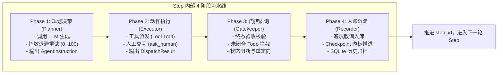

# Agent 核心状态机与 StepContext 流水线解耦重构设计

## 一、背景与设计动机

随着智能体功能的不断扩展（支持本地文件、网络检索、SQLite 任务数据区、MCP 插件、人工交互、终态质询与避坑沉淀），当前的 `main_loop.rs`、`loop_runner.rs` 和 `dispatcher.rs` 承担了极其庞大的职责。

### 1. 当前存在的设计痛点
1. **参数爆炸与散乱指针（Parameter Explosion）**：
   - 跨阶段调用时函数签名需要传递 15~17 个散落参数（`&app`, `&state`, `&mut context`, `&mut checkpoint`, `&mut rx`, `&mut interrupt_rx`, `session_id`, `step_id`, `run_machine` 等）。
   - 任何内部状态的新增或调整，都会破坏所有下游函数的签名。
2. **工具派发庞大臃肿（Monolithic Dispatcher）**：
   - `dispatcher.rs` 内部使用上千行的 `match tool_name { ... }` 分发所有原生工具与 MCP 插件，新增或维护一个工具需要改动核心分发器代码。
3. **单步流程阶段职责重叠**：
   - 规划生成、工具执行、人工交互、终态质询（Gatekeeper）、避坑沉淀（Lesson）杂糅在同一段大循环中，不利于独立测试与复用。

---

## 二、核心设计方案：StepContext 上下文对象模式

通过引入 `StepContext` 结构体，将每次任务步骤（Step）中所需的状态句柄、跨步记忆、SQLite 游标与 IPC 打断信道统一收纳。

### 1. `StepContext` 结构体定义

```rust
use crate::agent::context::AgentContext;
use crate::agent::checkpoint::Checkpoint;
use crate::agent::run_state::RunStateMachine;
use crate::agent::control::HumanControl;
use tauri::AppHandle;
use tokio::sync::{mpsc, watch};

/// 单步执行全量上下文句柄
pub struct StepContext<'a> {
    /// Tauri IPC 应用句柄（用于实时 20FPS 进度与状态推送）
    pub app: &'a AppHandle,
    /// 会话与任务标识
    pub session_id: &'a str,
    pub run_id: &'a str,
    pub step_id: usize,
    pub user_goal: &'a str,

    /// 核心记忆与上下文（Todo列表、审查契约、历史消息、死循环检测）
    pub context: &'a mut AgentContext,
    /// 崩溃自愈检查点（持久化游标与恢复点）
    pub checkpoint: &'a mut Checkpoint,
    /// 状态机实例
    pub run_machine: &'a mut RunStateMachine,

    /// 人类干预与停止指令接收通道
    pub rx: &'a mut mpsc::Receiver<HumanControl>,
    /// 流式中断广播通道
    pub interrupt_rx: &'a mut watch::Receiver<u64>,
}
```

---

## 三、四阶段流水线架构（4-Phase Step Pipeline）

将大 `loop` 内部的执行过程解耦为 4 个职责单一的高内聚阶段：



### 1. 主状态机驱动循环示例

```rust
while checkpoint.step_id < MAX_STEPS {
    let mut step_ctx = StepContext {
        app: &app,
        session_id: &final_session_id,
        run_id: &run_id,
        step_id: checkpoint.step_id,
        user_goal: &goal,
        context: &mut context,
        checkpoint: &mut checkpoint,
        run_machine: &mut run_machine,
        rx: &mut rx,
        interrupt_rx: &mut interrupt_rx,
    };

    // 1️⃣ 阶段一：想（规划决策）
    let instruction = PlannerPhase::plan(&mut step_ctx, &model_routing).await?;

    // 2️⃣ 阶段二：做（执行动作）
    let dispatch_result = ExecutorPhase::execute(&mut step_ctx, &instruction, &registry).await?;

    // 3️⃣ 阶段三：查（终态拦截与质询）
    let gate_outcome = GatekeeperPhase::evaluate(&mut step_ctx, &instruction, &dispatch_result)?;

    // 4️⃣ 阶段四：记（记忆入账与落盘推进）
    RecorderPhase::commit_step(&mut step_ctx, &instruction, &dispatch_result, gate_outcome).await?;

    checkpoint.step_id += 1;
}
```

---

## 四、工具体系解耦：`AgentTool` Trait 抽象

将分散在 `dispatcher.rs` 的 match 逻辑抽象为标准的异步 Trait，每个工具收敛在独立的模块中。

### 1. `AgentTool` 接口定义

```rust
use async_trait::async_trait;
use serde_json::Value;

#[async_trait]
pub trait AgentTool: Send + Sync {
    /// 工具名称（如 "web_search", "task_store", "artifact_manager"）
    fn name(&self) -> &'static str;
    
    /// 工具描述与使用规范（供提示词装配自动读取）
    fn description(&self) -> &'static str;
    
    /// 是否为写盘/破坏性操作（决定是否享受 1.5s 安全缓冲期）
    fn is_write_operation(&self) -> bool { false }

    /// 执行工具
    async fn execute(&self, params: Value, ctx: &mut StepContext<'_>) -> Result<DispatchResult, String>;
}
```

### 2. 工具目录规划

```text
src-tauri/src/agent/tools/
├── mod.rs               # ToolRegistry 注册表管理
├── web_search.rs        # 全网检索工具
├── web_fetch.rs         # 网页提取工具
├── task_store.rs        # 任务结构化数据区工具
├── artifact_manager.rs  # 独立受管交付物工具
├── ask_human.rs         # 人类交互与表单挂起工具
├── finish.rs            # 终态交付工具
├── model_manager.rs     # 模型规格管理工具
├── mcp_bridge.rs        # 外部 MCP 插件协议桥接
└── ...
```

---

## 五、重构带来的核心收益

1. **彻底消除参数地狱**：
   - 阶段函数与工具函数统一接收 `&mut StepContext<'_>`，未来扩展全局能力（如租户隔离、审计追踪）只需扩展结构体字段，零函数签名修改。
2. **极高的独立单测性（Mockability）**：
   - 可以通过构造 Mock `StepContext` 独立单测任意工具（如 `ask_human` 或 `web_search`）和任意阶段（如 `Gatekeeper` 终态质询拦截），无需启动完整的 Tauri 桌面端环境。
3. **即插即用的插件化扩展**：
   - 增加新工具仅需新建 `.rs` 文件并实现 `AgentTool`，在 `ToolRegistry` 注册一行即可全系统生效，核心调度循环实现零改动（遵循开闭原则 OCP）。
4. **向 Multi-Agent / 多智能体协作平滑演进**：
   - 多个智能体实例只需各自持有自己的 `StepContext`，即可在同一个 Tokio 异步运行时中并行或流水线协作调度。
