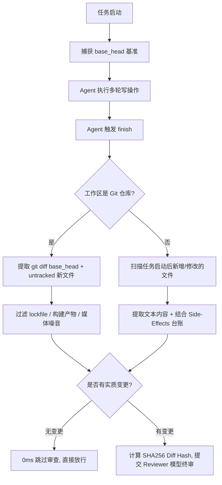

# Agent 终态审查门禁 (Reviewer Gatekeeper) 与多角色分工架构设计

本文档全面梳理与记录系统中 **Coder 执行者 + Reviewer 专家终审门禁** 的闭环控制设计，以及 **专精角色池（Role Cards）与提示词动态挂载** 的多角色协作体系。

---

## 目录
1. [设计哲学与分层架构](#一-设计哲学与分层架构)
2. [Reviewer Gatekeeper 终审门禁机制](#二-reviewer-gatekeeper-终审门禁机制)
   - [2.1 审查材料提取（Git 模式 vs 非 Git Fallback）](#21-审查材料提取git-模式-vs-非-git-fallback)
   - [2.2 复杂产物自适应识别（代码 vs Excel/PDF/二进制）](#22-复杂产物自适应识别代码-vs-excelpdf二进制)
   - [2.3 确定性门禁与阻断决策（Blocking Issues 判定）](#23-确定性门禁与阻断决策blocking-issues-判定)
   - [2.4 自愈重试与熔断机制（Retry & Fail-Open）](#24-自愈重试与熔断机制retry--fail-open)
3. [多角色分工与人设动态挂载体系](#三-多角色分工与人设动态挂载体系)
   - [3.1 角色卡池（Role Cards）设计](#31-角色卡池role-cards设计)
   - [3.2 级联菜单注入（Prompt Cascade Menu）](#32-级联菜单注入prompt-cascade-menu)
   - [3.3 运行时热重载（Runtime Hot-Reload）](#33-运行时热重载runtime-hot-reload)
   - [3.4 主 Agent 与子角色协同模式](#34-主-agent-与子角色协同模式)
4. [实操使用指南与配置建议](#四-实操使用指南与配置建议)

---

## 一. 设计哲学与分层架构

在复杂 Agent 编码与自动化任务中，单一模型容易陷入**“自写自审、盲目自信”**的逻辑盲区。本系统采用**“过程自测 + 终态交叉终审 + 门禁仲裁”**的分层架构：

```
                    ┌────────────────────────────────────────────────────────┐
                    │                      主任务规划与调度                   │
                    │      (Main Agent: Todo 分解、命令执行、子任务派发)       │
                    └──────────────────────────┬─────────────────────────────┘
                                               │
                        ┌──────────────────────┴──────────────────────┐
                        ▼                                             ▼
         ┌─────────────────────────────┐               ┌─────────────────────────────┐
         │     👨‍💻 前端角色 (Frontend)   │               │     🛠️ 后端角色 (Backend)    │
         │  • 专精 Vue3 / CSS / UI     │               │  • 专精 Rust / API / 业务   │
         │  • 专属 Prompt & 独立模型   │               │  • 专属 Prompt & 独立模型   │
         └──────────────┬──────────────┘               └──────────────┬──────────────┘
                        │                                             │
                        └──────────────────────┬──────────────────────┘
                                               │ 产出代码/文件修改
                                               ▼
                              ┌─────────────────────────────────┐
                              │     过程自测 (Change Verification) │
                              │   • 测试命令运行 (cargo/npm test) │
                              │   • 文件改动真实有效性检验        │
                              └────────────────┬────────────────┘
                                               │
                                               ▼ Agent 发起 finish()
                        =================================================
                                     🔒 终态放行门禁仲裁区
                        =================================================
                                               │
                        [门禁 ①~⑤] 确定性内存门禁 (Todo/后台任务/契约)
                                               │ 全部通过
                                               ▼
                        [门禁 ⑥] 🧐 Reviewer 交叉终审 (Git Diff / 产物清单)
                                               │
                                 ┌─────────────┴─────────────┐
                                 ▼                           ▼
                        【存在 Blocking Issues】     【通过 / 0ms 免检】
                                 │                           │
                        打回 Coder 针对性自愈修复        正式放行并交付成果
```

### 核心设计原则
1. **单一仲裁点（Single Arbitration Point）**：`finish` 是唯一验收放行入口。不在工具调用中间掺杂繁杂状态机，保持链路清晰。
2. **缺陷阻断而非模糊打分**：不以“分数（Score）”作为门禁，严格依据是否存在 `blocking_issues`（阻塞性缺陷）决定放行还是打回。
3. **零开销免检（Zero Overhead）**：纯咨询、分析或无文件修改的任务，0ms 直接放行，不消耗额外 Token。
4. **安全放行（Fail-Open）**：Reviewer 模型不可达、网络抖动或 JSON 解析异常时降级放行，保证主业务不被非预期卡死。

---

## 二. Reviewer Gatekeeper 终审门禁机制

### 2.1 审查材料提取（Git 模式 vs 非 Git Fallback）

终审的核心是**“看相对任务起点的最终全量成果”**。无论中间修复了多少次，Reviewer 永远审查最终合并状态：



### 2.2 复杂产物自适应识别（代码 vs Excel/PDF/二进制）

系统不仅支持代码任务，还支持生成数据报表、复杂 Excel、文档等多模态任务：
- **文本/代码文件（`.rs`, `.vue`, `.ts`, `.py`, `.md`, `.json` 等）**：提取完整或截断的内容切片供代码 Reviewer 审阅。
- **二进制产物（`.xlsx`, `.pdf`, `.docx`, `.zip`, `.png` 等）**：自动识别为产物，报告文件名、文件大小与生成状态，**避免乱码 Diff 污染 Prompt**。
- **外部副作用台账（Side-Effects Ledger）**：注入执行过的不可逆物理操作，让审查者掌握全局操作上下文。

### 2.3 确定性门禁与阻断决策（Blocking Issues 判定）

在唤醒 Reviewer 之前，必须 100% 跑通前 5 道确定性内存门禁：
1. **Todo 门禁**：所有计划任务必须为 completed 状态；
2. **后台任务门禁**：不得残留未处理的异常/挂死后台进程；
3. **测试命令自测门禁**：若定义了 `default_test_command`，必须提供成功的测试执行证据；
4. **文件验证门禁 (`ChangeVerification`)**：写操作必须真实落地；
5. **交付契约门禁 (`ReviewContract`)**：摘要说明完整。

Reviewer 按照结构化 JSON 返回判定：
```json
{
  "verdict": "passed" | "rejected",
  "score": 88,
  "blocking_issues": [
    {
      "file": "src-tauri/src/agent/reviewer.rs",
      "issue": "缺少边界空指针检查，可能引发 panic",
      "requirement": "添加 Option::unwrap_or 安全兜底"
    }
  ],
  "nit_issues": [
    {
      "file": "src-tauri/src/agent/reviewer.rs",
      "suggestion": "建议提取常量 MAX_RETRY_COUNT"
    }
  ],
  "summary": "发现 1 处严重阻塞缺陷，打回修复"
}
```
- `blocking_issues` 不为空 $\rightarrow$ 打回重修；
- `nit_issues` 仅记录建议，**绝不阻断交付**。

### 2.4 自愈重试与熔断机制（Retry & Fail-Open）

```
[Reviewer 打回] ──► 注入缺陷清单至对话历史
                        │
                  Coder 针对性修复代码
                        │
                  再次调用 finish
                        │
                  计算新变更的 diff_hash
                        │
         ┌──────────────┴──────────────┐
         ▼                             ▼
【diff_hash 未变（Coder 敷衍未改）】    【diff_hash 改变（真实修复）】
  复用上次拦截，避免浪费 Token           触发 Reviewer 重新终审
                        │
              重试次数达到 3 次上限
                        │
                  熔断升级人工介入
```

---

## 三. 多角色分工与人设动态挂载体系

### 3.1 角色卡池（Role Cards）设计

在数据库 `agent_role_cards` 表中持久化专精角色卡：

| 字段 | 含义 | 说明示例 |
|---|---|---|
| `name` | 角色标识（唯一键） | `frontend`, `backend`, `reviewer`, `scout` |
| `label` | 角色中文名 | 前端工程师、后端架构师、终审专家 |
| `model_id` | 钉死模型 ID（可选） | 为空则跟随全局档位，指定则强制该模型 |
| `persona_prompt` | 专精人设系统提示词 | 专精的技术栈、代码风格、安全考量约束 |
| `scope_hints` | 作用域路径提示 | `src/`, `src-tauri/src/` |
| `default_test_command` | 默认测试命令 | `npm run test`, `cargo test` |
| `enabled` | 是否启用 | 动态开关 |

### 3.2 级联菜单注入（Prompt Cascade Menu）

系统每次启动任务时，自动从数据库查询所有启用的角色卡，并无缝注入主 Agent 的系统提示词末尾：

```markdown
### 专精角色池（派发 child_reviewer/child_writer 时传 "role": "角色标识" 即可挂载人设与专属模型）
- [frontend] 前端工程师：专注 Vue3/CSS 组件设计与用户体验...（钉死专属模型: claude-3-7-sonnet；作用域: src/）
- [backend] 后端工程师：专注 Rust/数据库并发与安全架构...（钉死专属模型: gemini-2.5-pro；作用域: src-tauri/）
- [reviewer] 终态审查专家：资深架构与代码质量审查专家...（钉死专属模型）
```

**主 Agent 由此天然知道有哪些角色可用、擅长什么、该怎么派发**。

### 3.3 运行时热重载（Runtime Hot-Reload）

* **无状态实时查库**：每次执行派发动作（如 `child_writer`, `child_reviewer`, `evaluate_finish_diff`）时，系统都会实时调用 `resolve_enabled_card` 从 SQLite 查询最新配置。
* **即改即生效**：在任务执行过程中，用户随时在 UI 界面调整模型映射或修改人设提示词，**下一个步骤派发立即生效，无需重启任务**。

### 3.4 主 Agent 与子角色协同模式

```
用户请求："开发一个导出用户报表功能"
   │
   ▼
主 Agent（Planner / Coordinator）
   ├─ 1. 分析整体任务，拆分步骤
   ├─ 2. 派发后端: child_writer { role: "backend", task: "编写导出 Excel 的后端接口" }
   ├─ 3. 派发前端: child_writer { role: "frontend", task: "编写前端导出按钮与下载进度条" }
   ├─ 4. 执行测试验证: npm run test / cargo test
   └─ 5. 触发 finish()
          │
          ▼
     Reviewer Gatekeeper（终审角色）
          └─ 一次性对前后端全量 Diff 进行交叉审查
```

---

## 四. 实操使用指南与配置建议

### 1. 日常使用方式
- **零干预**：正常发起任何任务，主 Agent 自行规划与编码，终审门禁在后台全自动运转；
- **进度可见**：前端会实时收到审查状态通知（`🧐 专家评审员正在对任务变更与成果进行终审...`）；
- **自愈闭环**：若发现缺陷，AI 自行根据清单修复，无需用户手动复制报错。

### 2. 角色配置推荐

| 角色 Name | 推荐绑定模型 | 提示词核心重点 |
|---|---|---|
| `reviewer` | 强推理模型 (如 Claude 3.7 / GPT-4.5 / Gemini Pro) | 专注逻辑漏洞、破坏性改动、边界条件，严查阻塞性缺陷 |
| `backend` | 代码与逻辑强模型 (如 Claude Sonnet / DeepSeek-V3) | 规范 API 设计、异步并发安全、SQL 防注入、单元测试 |
| `frontend` | 前端精通模型 (如 Claude Sonnet) | Vue3/React 规范、响应式状态管理、UI 审美与无障碍访问 |
| `scout` | 快速模型 (如 Gemini Flash) | 代码库大范围快速检索、依赖探查、日志分析 |

### 3. 自定义主 Agent 协调指令（可选）
如果希望主 Agent 更加主动地按照角色分工拆解任务，可在 **「自定义能力 / 指令」** 中添加如下规则：
```text
【多角色协同分工规则】
当面对跨栈复杂任务时，请优先使用专精角色进行拆分执行：
1. 涉及 UI/组件/样式开发时，使用 child_writer 并指定 role: "frontend"；
2. 涉及 接口/数据库/系统层开发时，使用 child_writer 并指定 role: "backend"；
3. 涉及 方案预研/长日志分析时，使用 child_scout 并指定 role: "scout"。
所有改动完成后，调用 finish 交由 reviewer 进行全量终审。
```
