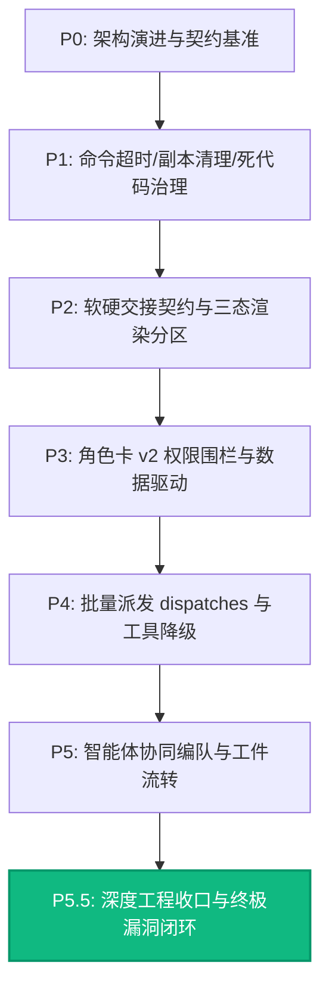

# P5.5 工程收口与多 Agent 架构终极闭环总结

> **归档时间**：2026-09-02  
> **项目状态**：P0 ~ P5.5 全量落地完成  
> **自动化测试**：Rust 单元测试 **353 passed / 0 failed / 2 ignored**，前端 TypeScript **0 error**  
> **代码规模**：95 个 Rust 模块（47k+ 行）、30 个 Vue 组件（28k+ 行），工程纯代码量突破 **85,000 行**

---

## 一、 演进全景：从 P0 到 P5.5 的收官轨迹

从最初的 Agent 单循环，到引入受限特种兵子 Agent，再到本次 P5.5 的深水区工程收口，项目经历了完整的工业级演进弧线：



---

## 二、 P5.5 重点收口与缺陷修复核对表

在终审环节，我们针对潜藏的 8 项深层隐患进行了全量代码级攻坚，不留死角：

| 编号 | 审查隐患 / 架构空缺 | 根因分析 | 修复方案与实际落地 | 验证结论 |
|---|---|---|---|---|
| **1** | **启动僵尸副本清扫不存在** | 异常断电/强退（`kill -9`）导致 Drop 守卫不触发，磁盘以 200MB/次永久泄漏 | 实现 `cleanup_orphaned_writer_workspaces`，挂载入 `lib.rs.setup` 开机钩子。双层兜底（DB 登记副本 + 扫描工程根目录下 `.writer-*` 物理孤儿目录）；开机自动将上次崩溃的 `running` 子任务标记为 `interrupted` | ✅ 单元测试已覆盖，开机清扫正常 |
| **2** | **`patch_ref` 重建断链** | 降级提示词曾指导大模型调用 `get_step_output`，导致工件系统与步骤日志混淆报错 | 修正 Tier 3/4 提示词契约，明确指导大模型调用 `artifact_manager(action: "get", id: "{art.id}")`，返回确切工件 ID | ✅ 提示词与代码契约彻底打通 |
| **3** | **并发计数为“累计终身制”** | COUNT 查询无 `status='running'`，长任务或追问在 6 次调用后直接耗尽终身配额 | 全局与角色级 COUNT 查询全面增加 `AND status = 'running'`；当任务完成进入终态时，立即自动释放并发槽位 | ✅ 单元测试验证槽位释放后新任务可立即进入 |
| **4** | **三态指纹 TOCTOU 竞争漏洞** | 指纹仅在 writer 终态采样，到父 Agent 真正消费时存在时间差；非 UTF-8 编码存在误判 | 1. 统一底层指纹为 `compute_bytes_hash` 纯字节流计算；<br>2. 新增 `refresh_file_conflicts`，在 `main_loop.rs` 信箱消费注入的**交付瞬间**现算指纹，彻底闭合 TOCTOU 竞争窗口 | ✅ 单元测试验证外部修改被消费侧实时捕获 |
| **5** | **`consumed_at` 替代破坏性置 NULL** | 过去轮询消费后直接 `SET result_json = NULL`，导致回放审计和追问（resume）断链 | DB 新增 `consumed_at TEXT` 字段并支持平滑迁移；消费后标记时间戳，永久保留 `result_json` 供审计与 resume 继承 | ✅ 单元测试验证信箱防重复消费且数据完好 |
| **6** | **LLM 伪造提额旁路封堵** | 大模型入参曾可能携带 `max_concurrency` 破坏安全底线 | 派发前全面 `remove("max_concurrency")`，强制由数据库角色卡配额主导，并与全局上限取 `min` | ✅ 剥离代码已在派发三角色处全面生效 |
| **7** | **Reviewer Gatekeeper 门禁校验** | 门禁卡未校验角色类型，可能滥用非 reviewer 角色 | 补充 `card.allows_kind("reviewer")` 校验；未授权时优雅降级为路由默认模型与空人设 | ✅ 门禁防御生效 |
| **8** | **批发熔断与死代码治理** | 曾存在内联重复实现，`SandwichContext` 里的 helper 未被调用 | 全面接入 `check_batch_dispatch_allowed` 和 `record_batch_dispatch_outcome`；连续 2 次批发解析失败触发 3 步熔断降级并倒数自愈 | ✅ 单元测试覆盖触发与倒数恢复全流程 |

---

## 三、 核心代码接线点对照

### 1. 启动僵尸副本双层清理 (`child_writer.rs` & `lib.rs`)
```rust
// 启动瞬间执行，安全且不误删真实工作区
pub fn cleanup_orphaned_writer_workspaces(db: &DbState) -> usize {
    let Ok(conn) = db.0.lock() else { return 0; };
    // 标记旧崩溃任务
    let _ = conn.execute("UPDATE agent_child_runs SET status = 'interrupted' WHERE status = 'running'", []);
    // 扫库中记录
    // 扫磁盘 .writer-* 孤儿目录
}
```

### 2. 父 Agent 消费回执瞬间现算指纹 (`main_loop.rs:1122-1145`)
```rust
if let Some(ref mut wr) = writer_res {
    // 🌟 核心：在父 Agent 消费回执的瞬间现算指纹，闭合 TOCTOU 竞争窗口！
    crate::agent::child_writer::refresh_file_conflicts(&mut wr.changed_files, &workspace_dir, git_available).await;
    // 实时注入 [✅ 可直接重放] 或 [⚠️ 发生冲突] 标签及 Diff 预览
}
```

### 3. 熔断降级辅助函数收敛 (`loop_runner.rs` & `context/types.rs`)
```rust
// 前置拦截
if let Err(breaker_msg) = context.check_batch_dispatch_allowed(inst.has_dispatches()) {
    return Ok(DispatchResult { stdout: String::new(), stderr: breaker_msg, success: false, route: "host_rejection:batch_circuit_breaker".into() });
}

// 结果结算（连续 2 次失败触发 3 步单发保护期）
let breaker_alert = context.record_batch_dispatch_outcome(success_count > 0);
```

---

## 四、 架构总结：为什么系统既健壮又极具灵活性？

1. **没有“写死”的业务逻辑**：
   * **角色卡在 SQLite 库中**：角色名称、模型偏好、人设、并发上限、硬范围均可通过配置或前端随时调整。
   * **决策在大脑 Prompt 中**：何时派发子任务、怎样规划步骤，全由 `core_logic.md` 驱动，改 Prompt 即改行为。
2. **硬底线坚如磐石**：
   * 严防子任务递归套娃（杜绝 Token 与内存雪崩）。
   * 写入隔离在 `.writer-*` 沙箱，带 Git 快照，主工作区天然免疫脏写。
   * 零 Token 轮询与持久化信箱，协程反应式唤醒，0 CPU 空转。
3. **高扩展性管道**：
   * 未来支持异构模型混编（低成本模型当侦察兵，高思考模型当主参谋）。
   * 支持针对各角色的细粒度 MCP 插件装载。

---

## 五、 验证结账单

```bash
# Rust 自动化测试全量通过（353 个用例无一失败）
cargo test --lib
test result: ok. 353 passed; 0 failed; 2 ignored; finished in 5.89s

# 前端 TypeScript 编译检查
npx vue-tsc --noEmit
# 0 error
```
