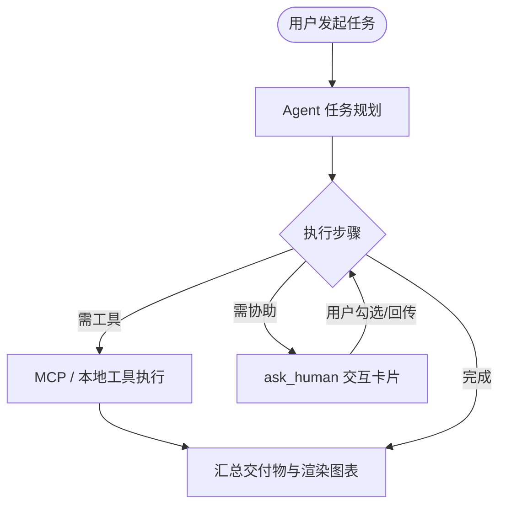
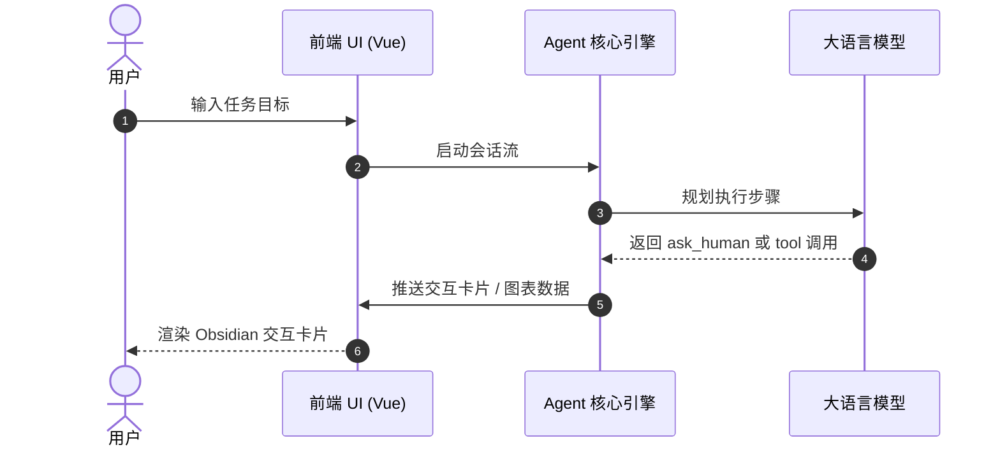

# 数据与架构图表可视化规范 (Data Visualization & Architecture Skill)

<summary>ECharts 交互图表、Mermaid 架构流程图与 HTML 动态沙箱报表规范与组件模板。</summary>

<when_to_use>需要生成折线/柱状/力导向等专业图表、数据大屏、可视化看板或架构流程图时。</when_to_use>

当你在回答用户、总结分析结果、呈现数据对比、系统架构设计或实体关系分析时，请优先使用结构化代码块输出可视化图表。前端渲染器会自动将其编译为交互式的高质感图表。

---

## 一、 ECharts 数据图表规范 (````echarts ... ````)

当你需要展示**柱状图、折线图、饼图、雷达图、桑基图、或知识图谱/关系网络**时，请输出 ```echarts 代码块，内部必须包含标准的 ECharts Option JSON 配置：
- **运行环境**：依赖宿主全局 ECharts 5 运行时，直接输出合法 Option JSON；
- **容器自适应**：图表容器具备响应式能力，建议设置显式最小高度（如 `min-height: 400px`）。

### 1. 知识图谱 / 关系拓扑图 (D3 风格力导向关系网络)
```echarts
{
  "title": { "text": "系统模块依赖关系图谱" },
  "tooltip": {},
  "series": [
    {
      "type": "graph",
      "layout": "force",
      "roam": true,
      "draggable": true,
      "force": {
        "repulsion": 180,
        "edgeLength": [80, 160]
      },
      "data": [
        { "name": "AgentCore", "symbolSize": 55, "itemStyle": { "color": "#6c63ff" } },
        { "name": "LLM Router", "symbolSize": 45, "itemStyle": { "color": "#00d4aa" } },
        { "name": "MCP Server", "symbolSize": 45, "itemStyle": { "color": "#ffa43d" } },
        { "name": "SQLite DB", "symbolSize": 40, "itemStyle": { "color": "#38bdf8" } },
        { "name": "ECharts View", "symbolSize": 40, "itemStyle": { "color": "#ff4757" } }
      ],
      "links": [
        { "source": "AgentCore", "target": "LLM Router", "label": { "show": true, "formatter": "调用推理" } },
        { "source": "AgentCore", "target": "MCP Server", "label": { "show": true, "formatter": "执行工具" } },
        { "source": "AgentCore", "target": "SQLite DB", "label": { "show": true, "formatter": "持久化会话" } },
        { "source": "AgentCore", "target": "ECharts View", "label": { "show": true, "formatter": "流式渲染" } }
      ]
    }
  ]
}
```

### 2. 多维度数据对比柱状图 / 折线图
```echarts
{
  "title": { "text": "各模型推理耗时与吞吐量对比" },
  "tooltip": { "trigger": "axis" },
  "legend": { "data": ["平均延迟(ms)", "每秒Token数"] },
  "xAxis": {
    "type": "category",
    "data": ["DeepSeek-V3", "Claude 3.5 Sonnet", "GPT-4o", "Gemini 1.5 Pro"]
  },
  "yAxis": [
    { "type": "value", "name": "延迟 (ms)" },
    { "type": "value", "name": "TPS" }
  ],
  "series": [
    { "name": "平均延迟(ms)", "type": "bar", "data": [420, 680, 590, 480] },
    { "name": "每秒Token数", "type": "line", "yAxisIndex": 1, "data": [65, 45, 52, 58] }
  ]
}
```

### 3. 占比与构成饼图 / 环形图
```echarts
{
  "title": { "text": "Token 消耗分布" },
  "tooltip": { "trigger": "item" },
  "series": [
    {
      "type": "pie",
      "radius": ["40%", "70%"],
      "avoidLabelOverlap": false,
      "data": [
        { "value": 1048, "name": "System Prompt" },
        { "value": 735, "name": "Tool Definitions" },
        { "value": 580, "name": "Conversation Context" },
        { "value": 484, "name": "Agent Thoughts" }
      ]
    }
  ]
}
```

---

## 二、 Mermaid 架构与时序图规范 (````mermaid ... ````)

当你需要展示**业务流程图、模块交互时序图、状态机转换、或甘特计划**时，输出 ```mermaid 代码块：

### 1. 架构流程图 (Flowchart)


### 2. 时序交互图 (Sequence Diagram)


---

## 三、 HTML 动态应用与单页应用实时沙箱预览 (````html ... ````)

当你被要求**编写前端单页应用、小游戏、数据交互看板、或交互原型**时，直接输出完整的 ```html 代码块（包含 HTML + CSS + JS）。
前端会自动将其渲染为**带有 [🌐 实时预览] 与 [💻 源代码] Tab 切换的高性能沙箱**，用户可以直接在界面中点击试玩、全屏沉浸预览或导出 `.html` 文件！
- **双向交互能力**：HTML 沙箱内部支持调用 `Agent.submit(data)` 交互回传数据给 Agent 会话；**严禁要求用户手动复制 JSON 文本回复**。

### 范例：交互式小工具或小游戏
```html
<!DOCTYPE html>
<html lang="zh-CN">
<head>
  <meta charset="UTF-8">
  <title>任务进度与番茄钟</title>
  <style>
    body { font-family: -apple-system, BlinkMacSystemFont, sans-serif; background: #141416; color: #f4f4f5; display: flex; flex-direction: column; align-items: center; justify-content: center; height: 100vh; margin: 0; }
    .card { background: #1f1f23; padding: 24px 32px; border-radius: 12px; border: 1px solid rgba(255,255,255,0.1); text-align: center; }
    .timer { font-size: 48px; font-weight: bold; color: #6c63ff; margin: 16px 0; font-family: monospace; }
    button { padding: 8px 18px; border-radius: 6px; border: 0; background: #6c63ff; color: #fff; font-weight: bold; cursor: pointer; }
    button:hover { background: #7c73ff; }
  </style>
</head>
<body>
  <div class="card">
    <h2>⚡ 实时交互演示</h2>
    <div class="timer" id="clock">25:00</div>
    <button onclick="toggle()">开始计时</button>
  </div>
  <script>
    let sec = 1500, timer = null;
    function toggle() {
      if (timer) { clearInterval(timer); timer = null; }
      else {
        timer = setInterval(() => {
          sec--;
          const m = String(Math.floor(sec / 60)).padStart(2, '0');
          const s = String(sec % 60).padStart(2, '0');
          document.getElementById('clock').innerText = `${m}:${s}`;
        }, 1000);
      }
    }
  </script>
</body>
</html>
```
